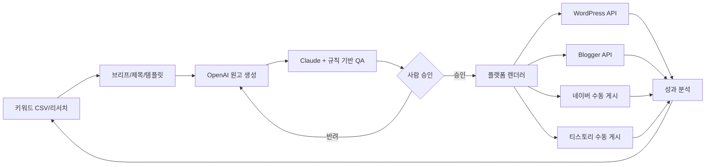

# ContentFlow AI v2.0

> **멀티채널 AI 블로그 콘텐츠 운영 SaaS — 기획/설계 단계**
>
> 키워드 리서치 → 출처 기반 작성 → AI 교차 검수 → 사람 승인 → 플랫폼별 발행 → 검색/광고 수익 분석

**상태:** 설계 문서 v2.0 (구현/서비스 출시 전) · **최종 정리:** 2026-11-05  
**지원 대상:** 네이버 블로그, 티스토리, WordPress, Blogger, 자체 블로그  
**기술:** Next.js · React · TypeScript · Tailwind CSS · shadcn/ui · Supabase/PostgreSQL · n8n · OpenAI API · Claude API · Tiptap · React Flow

## 1. 프로젝트 소개
ContentFlow AI는 단순한 글 자동 생성기를 넘어, **블로그 콘텐츠를 검색 유입과 수익으로 연결하는 운영 플랫폼**이다. 하나의 키워드와 검증된 근거를 바탕으로 **채널별 특성이 다른 독립 콘텐츠 버전**을 작성하며, 사람이 승인한 결과물만 발행한다. 애드센스·애드포스트·제휴 수익과 API/제작비를 함께 분석한다.

### 문제
- 키워드 조사, 제목 작성, 출처 검증, 편집 및 발행이 분산되어 있다.
- 플랫폼별 제목/본문 패턴과 발행 인터페이스가 다르다.
- 대량 AI 작성 시 근거 부족·중복·정책 위반 위험이 있다.
- 글 수만 추적하고 글별 유입·순이익을 보지 못한다.

### 해결
**Keyword Explorer → Title Lab → Template Builder → AI Writer → QA Center → Approval → Channel Publisher → Analytics**

## 2. 원칙 및 경계
1. **검증을 우선**: 핵심 주장과 공식 출처/확인일 연결. AI 검수만으로 사실 판정 금지.
2. **수익 주장 검증**: 광고 수익 보장 금지. CPC·RPM 수치와 실측/가정을 구분.
3. **원본성**: 다른 블로그의 고유 문장/디자인 복사 금지. 이용자 경험, 실험, 원본 데이터를 활용.
4. **최종 승인**: MVP는 사람의 승인 없이 외부 발행하지 않는다.
5. **합법적 API**: WordPress REST API/Blogger API는 승인 후 연동, 티스토리·네이버는 HTML/에셋 발행 패키지와 수동 게시.
6. **보안**: 멀티테넌트 RLS, 비밀 토큰 서버 측 관리, 권한별 접근제어.

## 3. 주요 기능
| 모듈 | MVP | 확장 |
|---|---|---|
| 키워드/클러스터 | CSV 입력, 의도/우선순위, 중복 검사 | 검색량·계절성 자동 수집 |
| 제목 생성 | 검색형/홈판형/비교형 제목 5개, 평가 | 게시 전후 제목 실험 |
| 콘텐츠 템플릿 | 10종 템플릿·플랫폼 규칙 | 비주얼 블록 빌더 |
| AI 콘텐츠 | OpenAI 초안, Claude 리뷰, 비용 로깅 | 모델 라우팅·다국어 |
| 검수 | 사실/출처/권리/광고/중복 게이트 | 변경 감시·시맨틱 중복 |
| 발행 | WP/Blogger API, 티스토리/네이버 수동 패키지 | 자체 CMS/예약 |
| 분석 | Search Console/GA4 연결 구조 | 광고 매출·기여/ROI |
| 운영 | 조직/블로그/권한 | 결제, 크레딧, 대행사 |

## 4. 콘텐츠 전략
- **네이버 검색형**: 명확한 문제·대상·경험/출처.
- **네이버 홈판형**: 독자 관심과 실제 사례/시각 자료 중심. 허위 경험 금지.
- **티스토리**: 해결형·롱테일·FAQ·단계별 이미지, 발행 수동.
- **WordPress/Blogger**: 검색 의도, 전문 가이드, 독립 도메인, 내부 링크/기술 SEO.
- **GEO**: 독창적 자료, 엔티티의 명확한 설명, 출처와 갱신일. 노출 보장은 불가.

## 5. 시스템 흐름

## 6. 저장소 문서
| 분류 | Markdown 원본 | PDF 배포본 |
|---|---|---|
| 제품 기획 | [PRD](docs/01-planning/PRD.md) | [PRD.pdf](docs/01-planning/PRD.pdf) |
| 기술 설계 | [SYSTEM_ARCHITECTURE](docs/02-architecture/SYSTEM_ARCHITECTURE.md) | [PDF](docs/02-architecture/SYSTEM_ARCHITECTURE.pdf) |
| DB | [DATABASE_SCHEMA](docs/03-database/DATABASE_SCHEMA.md) | [PDF](docs/03-database/DATABASE_SCHEMA.pdf) |
| 콘텐츠 | [CONTENT_TEMPLATES](docs/04-content/CONTENT_TEMPLATES.md) | [PDF](docs/04-content/CONTENT_TEMPLATES.pdf) |
| 개발 에이전트 | [AGENTS](docs/05-agents/AGENTS.md) | [PDF](docs/05-agents/AGENTS.pdf) |
| 자동화 | [WORKFLOWS](docs/06-workflows/WORKFLOWS.md) | [PDF](docs/06-workflows/WORKFLOWS.pdf) |

> PDF는 아래 GitHub Actions 문서 빌드로 생성되며, 워크플로 실행 전에는 링크가 존재하지 않을 수 있습니다.

## 7. 개발 순서 및 Done 기준
1. **Foundation:** Next.js 로그인·Supabase 마이그레이션·RLS 교차 테넌트 차단 테스트.
2. **Content MVP:** CSV 30개 입력, 10종 템플릿, 제목/원고/QA, 버전 기록.
3. **Publisher:** 사람 승인, WordPress/Blogger 초안 API, 네이버/티스토리 ZIP/HTML 패키지.
4. **Analytics:** 검색 노출·클릭·수익 지표(실측/추정 구분).
5. **SaaS:** 결제·크레딧·팀 역할·고객별 과금/비용 감시.

`docs/` 문서는 제품 의사결정의 기준이며, 실행 코드/비밀키/원본 유료 PDF는 포함하지 않는다.

## 8. 참조·권리
2026년 블로그 운영 PDF 16개와 관리용 XLSX 1개에서 **개념·운영 흐름만 추출**해 독자적으로 작성한 명세이다. 원본 전자책/유료 스킨은 재배포하지 않는다. 블로그 규칙과 API는 배포 시점의 공식 문서로 재확인한다.
