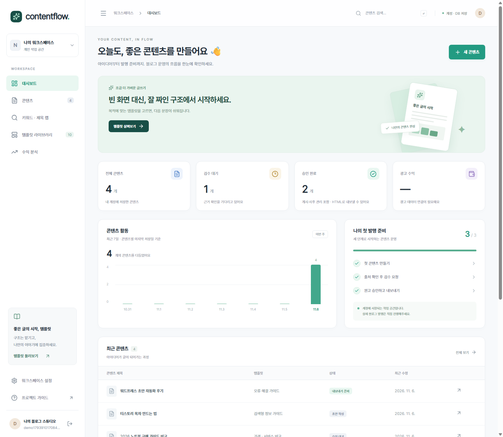
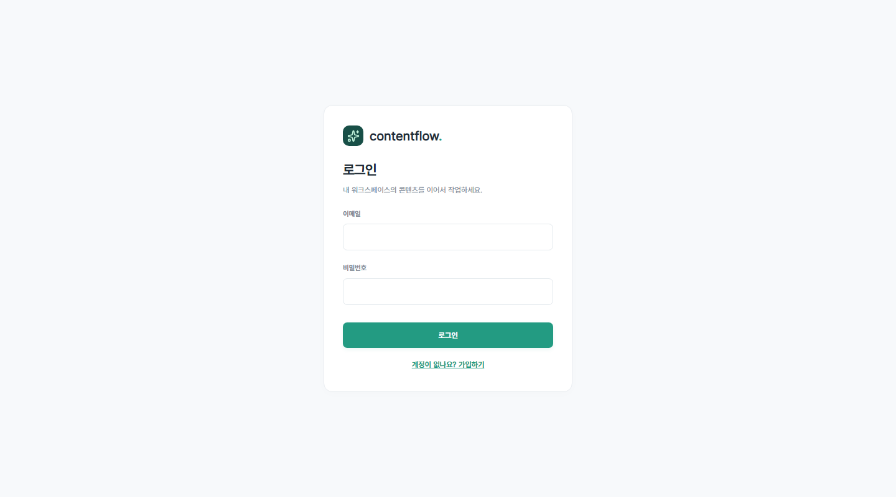
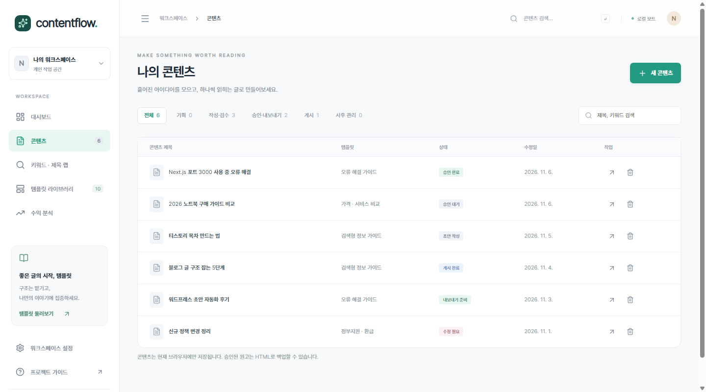
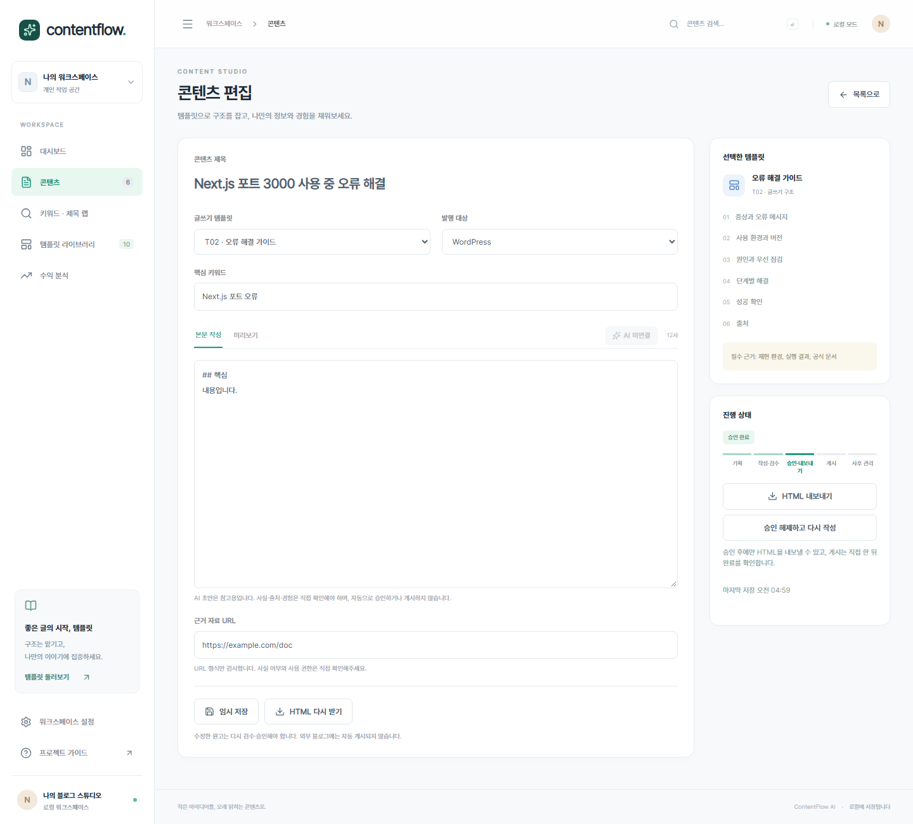
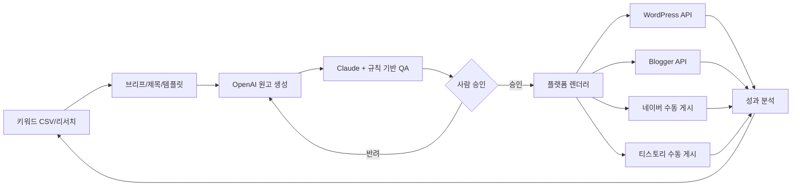

# ContentFlow AI v2.0

> **블로그 콘텐츠 대시보드 — 템플릿 선택·작성·검수·로컬 저장 구현**
>
> 키워드 리서치 → 출처 기반 작성 → AI 교차 검수 → 사람 승인 → 플랫폼별 발행 → 검색/광고 수익 분석

**상태:** 기획 v2.1 + 로컬·계정 대시보드 v0.1 (서비스 출시 전) · **최종 정리:** 2026-11-06

**최초 출시 제안:** WordPress 초안 + 티스토리 수동 패키지 · **후속 대상:** Blogger, 네이버, 자체 블로그
**기술 설계:** Next.js · React · TypeScript · Tailwind CSS · shadcn/ui · Supabase/PostgreSQL · n8n · OpenAI API · Claude API · Tiptap (React Flow는 후속)

`apps/web`에 실행 가능한 로컬 대시보드가 있다. 템플릿은 사이드바 메뉴와 콘텐츠 작성 화면에서 선택한다. Supabase를 설정하면 이메일 로그인과 DB 저장(상태 규칙을 DB 트리거가 강제), 설정하지 않으면 이 브라우저에만 저장한다. AI 초안·WordPress 초안 전송은 서버 키를 설정했을 때만 동작한다. 계정 모드에서는 팀 초대·역할·워크스페이스 전환과 수익 보고서 DB 저장을 지원한다. 광고 API 연결과 설치형 스킨은 후속이다. 기획 정본은 [PRD v2.1](docs/01-planning/PRD.md), 상세 실행안은 [수익화·템플릿 기획](docs/01-planning/MONETIZATION_STRATEGY.md)이다.

## 화면 미리보기

로그인한 계정(DB 저장)의 대시보드(1440px). 샘플 글 4개는 캡처용 테스트 계정 데이터이며 저장소에 포함되지 않는다. 더 많은 화면은 [디자인 시안](docs/07-design/DESIGN_SPEC.md).

| 로그인 | 콘텐츠 목록 | 승인된 글의 편집기 |
|---|---|---|
|  |  |  |

## 진행 현황 (2026-11-12 기준)

**2026-11-12 추가:** 아래 2026-11-11 목록 이후 작업이다. 마이그레이션 0018까지 로컬 적용.

| 묶음 | 내용 | 제한 |
|---|---|---|
| W9~11 리뷰 수정 (0018) | 키 정규화 JS·SQL 통일, 보관 블로그 계정 새 연결·기록 차단, 수익 미배분 합계 분리, 트렌드 카테고리별 점수 | lower()의 일부 특수 문자(Σ·İ) 차이 수용 |
| W8 브라우저 검증 | e2e 67건: 팀·인증 복구·수익·AI 검수·블로그 계정·트렌드·성과, 키보드, 저장 실패, 500/768/1000/1440px | 실제 운영 메일 미검증 |
| Supabase 로컬·Cloud 분리 | 주소로 대상 판정, Cloud 필수 설정 점검, env 예시 2종, 로컬·Cloud 스크립트 | Cloud 실제 생성·적용 안 함(승인 필요) |
| AI API 탭 · Gemini | 설정 → AI API에서 제공자(Gemini·OpenAI)·초안/검수 모델 선택·연결 테스트, 실제 Gemini 초안 생성 확인 | Gemini 단가 미설정 → 비용 N/A |
| 템플릿 예시 글 | 템플릿 10종 "예시 보기"(가상 정보 예시 글) | 예시 이미지는 Gemini 이미지 결제 전까지 자리표시자 |
| 화면 정리 | 좌측 메뉴 "나의 워크스페이스" 삭제, 첫 메뉴 대시보드, "환경설정" 이름 변경, 날짜 표시 Asia/Seoul 고정 | — |
| 필수 블록 차단 · 렌더러 r2 (CF-19) | T01/T02/T04 필수 소제목 누락 시 검수·승인(로컬·계정 API 422)·전달 차단, 미리보기·HTML에 목차와 GFM 표(모바일 가로 스크롤) | r3(표 래퍼 WordPress 호환), 이전 승인 글은 재승인 필요. W8 e2e 67건 재통과 |
| 모바일 앱 (Capacitor 8) | Android 앱(글 목록·상세·승인 대기, 읽기 전용), 서버 토큰(Bearer) 세션, 대시보드 APK 다운로드 카드, 개발용 APK 첫 빌드·서명 | iOS 미지원, 실기기 설치 확인 전, 개발용은 내부망 http |

**2026-11-11 추가 (MVP 잔여 작업, [계획](tasks/PLAN_MVP_REMAINING.md)):** 아래 표보다 이 목록이 최신이다. 마이그레이션 0007~0017 추가(로컬만 적용, 운영 DB 미적용).

| 묶음 | 내용 | 제한 |
|---|---|---|
| W1 AI 실행 기록 | 모델·프롬프트 버전·토큰·비용 추정(`agent_runs`) | 단가 환경변수 없으면 N/A, 실키 미검증 |
| W2 발행 이력 | 상태 전이 이력, 발행 시도·실패 유형, WordPress 재시도 중복 방지(`cf-<글ID>` slug) | 게시 전 slug 변경 필요 |
| W3 게시 확인·티스토리 | 게시 완료에 공개 URL 필수, 티스토리 ZIP 패키지 | 이미지 제외 |
| W4 표시·광고 프로필 | L01/L02/A00/A01, 렌더러 통합, 승인 해시 v2, 전달 전 검사 | L02 목차·비교표 없음, 기존 승인 글은 재승인 필요 |
| W5 사이트 준비 점검 | 항목별 상태·근거·확인 시각, 광고 상태 분리 | 계정 모드 전용 |
| W6 원가·개선 큐 | 원가 수동 입력, 개선 큐, 수익 CSV 시간대·기간·부분 중첩 거절 | 계정 모드 전용(수익 제외) |
| W7 검수 보완 | 브리프 필수값, 근거·권리 검토 승인 차단, 제목 평가 저장, 템플릿 버전 고정 | 템플릿 예제·필수 블록 차단 없음 |
| W9 블로그 계정 | 계정 관리, 글·키워드 연결, 공용 블로그 필터 | — |
| W10 트렌드 분석 | `/trends` 블로그 키워드 기회 점수, CSV·수동 입력 | 외부 API 미연동 |
| W11 성과 도구·블로그지수 | 네이버(블스피·블랙키위·블로그AI)·구글 계열(Search Console·Ubersuggest·Clarity) 기록, 블로그지수 추이, GSC CSV | 수동 입력·CSV, 블로그지수는 외부 도구 값 기록(비공식) |

### 완성도 (2026-11-12)

완성도는 PRD 항목과 검증 근거로 어림한 값이며 출시율이 아니다. 판정은 코드·단위 테스트·DB 규칙 테스트 기준이고, 새 기능의 실제 브라우저 흐름은 아직 확인하지 않았다.

| 기준 | 완성도 | 근거 |
|---|---|---|
| PRD MVP 기능 (P0-01~14) | 약 93% (완료 12, 부분 2) | 부분: P0-04 템플릿 예제·필수 블록 차단 없음, P0-12 L02 목차·비교표 없음 |
| 추가 범위 (블로그 계정·트렌드·성과 도구) | 구현·리뷰 수정 완료 | 0018: 키 정규화 JS·SQL 통일, 보관 계정 새 연결·기록 차단, 미배분 수익 합계 분리, 트렌드 카테고리별 점수 |
| 출시 준비 항목 8개 | 5/8 (기능 구현·리뷰 수정·브라우저 검증·AI 실키(Gemini)·문서 정합화) |
| 모바일 앱 (추가 범위) | W0 완료 | 개발용 APK 빌드·대시보드 배포까지. 남음: 실기기 확인, 정식(https) 채널, 구글 로그인, 쓰기 기능 | 아래 "남은 개발 단계" 2~8번 미완료 |

| 마일스톤 (PRD #10) | 상태 |
|---|---|
| M0 보안·DB | 로컬 완료. 클라우드 Supabase와 운영 마이그레이션 적용 없음 |
| M1 3종 제작·QA·승인 | 코드 완료. 실제 Gemini(gemini-3.5-flash) 초안 호출 확인, OpenAI 실키 미검증 |
| M2 WP 초안·티스토리 패키지 | 코드 완료. 브라우저 흐름과 실제 WordPress에서 slug 동작 미확인 |
| M3 성과·원가·개선 큐 | 코드 완료. 외부 지표는 CSV·수동 입력 |
| M4 파일럿 | 시작 전 |
| M5 API 수집·채널·SaaS 확장 | 시작 전 (Search Console·Clarity·네이버 데이터랩 API 연동 포함) |

### 남은 개발 단계

1. [x] MVP 잔여 기능(W1~W7)과 블로그 계정별 트렌드·성과 분석(W9~W11) 구현
2. [x] W9~W11 리뷰 수정 (마이그레이션 0018, [계획](tasks/PLAN_MVP_REMAINING.md)의 "W9~11 리뷰 수정")
3. [x] W8 브라우저 검증 (2026-11-12): e2e 67건 통과 — 팀·인증 복구·수익·AI 검수(가짜 서버)·블로그 계정·트렌드·성과, 키보드, 저장 실패, 500/768/1000/1440px 가로 넘침 0, 실제 WordPress 컨테이너 slug 선조회·유지
4. [x] 실제 AI 키 검증: Gemini 초안 호출 확인(2026-11-12). OpenAI 실키는 미검증(키 없음)
5. [ ] 클라우드 Supabase 생성과 마이그레이션 0001~0018 적용 (계정·비용 승인 필요). 준비 완료: 로컬/Cloud 환경 분리·점검·스크립트([Supabase 환경](docs/08-ops/SUPABASE_ENVIRONMENTS.md))
6. [ ] https 운영 배포와 운영 메일(가입 확인·비밀번호 복구·팀 초대) 설정 (승인 필요)
7. [x] 문서 정합화: DATABASE_SCHEMA 8절(0007~0018), ERD 재생성([ERD](docs/03-database/ERD.mmd)), WORKFLOWS 티스토리 이미지 제외. 남음: 블스피·블로그AI 정확한 주소
8. [ ] M4 파일럿: 운영자 3~5명의 편집 시간과 반복 사용 검증 (실제 사용자 필요)

후속(MVP 이후): P0-04 필수 블록 차단(템플릿 10종 예시 글은 2026-11-12 추가, 이미지는 Gemini 결제 후 `npx tsx --env-file=../../.env.local scripts/gen-template-images.ts`로 생성), L02 목차·비교표, 외부 분석 도구 API 연동, 이전 렌더 묶음 복원.

최근 추가된 기능은 팀·권한 관리, 인증 메일 콜백과 비밀번호 재설정, 수익 DB 저장, 키워드↔글 ID 연결, AI 검수 의견이다. 아래 표는 현재 코드 기준이며, 기존 [개발 단계와 완성도](docs/07-design/IMPLEMENTATION_STATUS.md)의 작업 수·완성도는 이번 추가분 이전 평가다. 화면 시안은 [디자인 시안](docs/07-design/DESIGN_SPEC.md).

| 영역 | 현재 상태 | 제한 사항 |
|---|---|---|
| 대시보드 | 개요·콘텐츠·템플릿·수익 분석·설정, 3구간 CSS | 작성/목록 화면만 스크린샷 확인; 저장된 글 상태·키보드·저장 실패는 미확인 |
| 템플릿 | 10종 카드, 검색/분류, 콘텐츠 화면 선택 | 글쓰기 골격이며 스킨·AI 생성 아님 |
| 키워드·제목 랩 | `/keywords`: CSV 가져오기(중복 건너뜀, 오류 행 보고), 규칙 기반 제목 후보 5개, 키워드/제목 후보에서 `아이디어` 단계 글 만들기, 연결된 글 상태 표시. **계정 모드는 DB 저장**(마이그레이션 0003, 중복·5,000개 상한을 DB가 강제), 브라우저 키워드 가져오기 | 로컬 모드는 브라우저 저장. 검색량·경쟁도 없음; AI 아님. 새 글은 키워드 ID로 연결하며, ID가 없는 기존 글만 문구 일치로 연결 |
| 상태 모델 | `lib/lifecycle.ts`: 16단계 전이 규칙, DB enum 일치 테스트. 편집기 진행 패널·목록 5단계 그룹 필터·대시보드에 연결 | 발행 중/발행 실패/초안 생성됨은 "CMS 연동 전"으로 비활성 표시. 게시는 수동 게시 후 운영자 확인 |
| 콘텐츠 | 생성/수정/검색/삭제, JSON 백업. 로그인 시 DB 저장(기기 간 동기화), 미설정 시 브라우저 저장(키 v2, v1은 읽을 때 변환·원본 보존). 설정에서 브라우저 데이터를 계정으로 가져오기 | 가져온 글은 승인 기록이 없어 초안으로 들어옴. JSON 가져오기·실시간 동기화 없음 |
| 검수/승인 | 검수 요청 시 본문·근거 URL 형식 검사 → 승인 대기 또는 수정 필요, 확인 체크 후 수동 승인. **검수 점검 패널**: 차단 항목(DB와 동일 규칙) + 차단하지 않는 경고 8종(제목 길이, 소제목/빈 섹션, 짧은 본문, 키워드 누락, 보장 표현, 예시/로컬 근거 주소, 같은 제목·키워드 중복) | 규칙 기반 점검은 사실/권리를 확인하지 않음. AI 검수 의견을 별도로 요청할 수 있으나 자동 승인하지 않음; 승인·게시 이후라도 내용 변경 시 초안 작성으로 복귀 |
| 내보내기 | 승인 이후 단계 원고만 HTML escape 후 다운로드, 승인 → 내보내기 준비 전환 | 외부 자동 발행·이미지 ZIP 없음 |
| 수익 분석 | `/analytics`: AdSense 등 보고서 CSV 가져오기(한/영 헤더, 예상·확정 구분, 통화), 기간별 요약, 페이지별 수익을 WordPress 글 주소와 연결. 예상/확정·통화를 합산하지 않고, 사이트 합계와 페이지 행 이중 집계 차단, 재가져오기 중복 건너뜀, 없는 값은 N/A | 계정 모드는 워크스페이스 DB 저장·브라우저 데이터 가져오기 지원(소유자/관리자만 가져오기·삭제); 로컬 모드는 브라우저 저장. 보고서 API·Search Console·GA4 연동과 제작 원가 장부 없음. 주소가 다른 페이지는 글에 임의 배분하지 않음 |
| Codex 팀 | NOMAD 도구·역할 5종·프로젝트 설정 추가 | 루나-6.1 정확한 ID 대기, 비활성 상태 |
| DB/RLS | `0001` 코어 스키마 + `0002` 글 본문 컬럼과 **상태 전이 트리거**(허용 전이만, 수정 시 승인 해제, 승인 시 불변 스냅샷·승인 기록·감사 로그). RLS/트리거 테스트(`supabase/tests/run.ps1`), 로컬 Supabase에 적용 | 클라우드 프로젝트 없음(로컬 전용). `0003` 키워드, `0004` 팀·역할, `0005` 키워드 ID·수익, `0006` 공유 호출 제한 추가. 운영 DB에는 별도 적용 필요 |
| 팀·권한 | 설정에서 초대·수락·거절·취소, 역할 변경·멤버 내보내기·탈퇴, 워크스페이스 전환. owner/admin/editor/reviewer/viewer 권한을 UI·API·DB에 적용 | 초대 메일은 발송하지 않음. 초대한 이메일로 가입·인증·로그인 후 설정에서 확인 |
| AI 검수 의견 | `POST /api/ai/review`: 근거 없는 주장·사실 오류·권리·출처·표현 점검 의견. `QA_MODEL`로 검수 모델 지정, 작성 모델과 같으면 표시 | `OPENAI_API_KEY` 필요. 의견은 저장·상태 변경·자동 승인하지 않음. 실키 호출 미검증 |
| 대량 조회·호출 제한 | 글·키워드·수익을 페이지별 조회해 기본 1,000행 제한 대응. 계정/인증 요청은 DB 공유 호출 제한 사용 | DB 제한 함수 실패 시 프로세스 메모리 제한으로 대체 |
| AI 초안 | `POST /api/ai/generate`: 키워드·템플릿으로 OpenAI 호환 API 호출, 소제목 고정, `[확인 필요]` 표시 | `OPENAI_API_KEY` 설정 시에만 동작. 실제 OpenAI 호출은 미검증(가짜 서버로 검증). 초안은 승인 전 사람이 확인 |
| WordPress | `POST /api/wordpress/draft`: 승인된 글을 **초안으로만** 생성, 재시도 시 같은 초안 갱신, 게시된 글은 덮어쓰지 않음. 계정 모드는 글 ID만 받아 DB의 상태·본문을 사용하고 동시 전송을 막음 | 실제 WordPress(Docker) 컨테이너로 생성·갱신·동시 전송·게시글 보호 검증. 게시는 직접 |
| Docker | `Dockerfile`(standalone, non-root), `docker-compose.yml`(읽기 전용 FS, 127.0.0.1 바인딩) | 이미지 327MB, healthcheck 통과 |
| 로그인/권한 | Supabase Auth 이메일 로그인(`/login`), httpOnly 세션 쿠키, `proxy.ts` 접근 제어, API는 서버에서 재확인, 같은 출처 검사·호출 제한. 브라우저는 Supabase와 직접 통신하지 않음 | 가입 확인 콜백·비밀번호 재설정 구현. 로컬 스택은 이메일 확인을 끔; 운영 메일·리다이렉트 설정과 실제 메일 흐름 검증 필요. 소셜 로그인 없음 |

### 기존 작업 묶음 (이번 추가분 이전 평가)

| 작업 묶음 | 완료/전체 | 판단 근거 |
|---|---|---|
| 기획 | 1/1 | PRD·수익화·DB·워크플로우 보강 |
| 로컬 대시보드/편집 | 5/5 | CF-02~04, CF-09~10 코드·테스트·빌드 |
| Docker·연동 | 2/3 | CF-11 Docker·Supabase, CF-13 WordPress 완료 / CF-12 AI는 실키 미검증 |
| 로그인·DB 저장 | 1/1 | CF-14 Auth·DB 트리거·API (사용자 2명 e2e 37건, WordPress e2e 16건) |
| 콘텐츠 운영 기능 | 3/3 | CF-15 키워드→글, CF-16 QA 패널, CF-17 키워드 DB, CF-18 수익 CSV |
| DB 스키마 | 1/1 | CF-07a 마이그레이션·RLS 테스트 |
| NOMAD 구성 도구 | 1/1 | CF-05 네이티브 역할·초기화/검사 도구 |
| 모델 활성화/시각 검증/백엔드 연동 | 0/3 | CF-06, CF-07b, CF-08 대기 |

### 구현된 주요 항목

- [x] 대시보드 메뉴와 콘텐츠 현황
- [x] 템플릿 라이브러리 → 콘텐츠 작성 및 편집 화면 내 템플릿 변경
- [x] 로컬 저장·검수·수동 승인·HTML 내보내기
- [x] 16단계 글 상태: 편집기 진행 패널, 목록 5단계 그룹 필터, v1 데이터 자동 변환
- [x] 이메일 로그인과 DB 저장, DB 트리거로 승인 우회 차단, 승인 스냅샷
- [x] 키워드 → 아이디어 → 자료 조사 → 브리프 → 초안 작성 → 검수 요청 흐름 (두 모드 모두 브라우저 e2e 25건)
- [x] 검수 점검 패널(규칙 기반 경고), 키워드 DB 저장, 수익 보고서 CSV 가져오기·집계
- [x] Docker 이미지, 로컬 Supabase, AI 초안, WordPress 초안 전송
- [x] NOMAD Codex 팀 초기화/검사 도구와 5역할 정의

### 다음 개발 단계 (2026-11-06 기준 기록, 최신은 위 "남은 개발 단계")

- [ ] 부 에이전트의 정확한 모델 ID 확인 후 팀 활성화
- [ ] 실제 브라우저에서 모바일/태블릿/데스크톱 검증
- [x] 팀 초대·역할 화면, 인증 메일 콜백/비밀번호 재설정, 수익 DB 저장, 키워드↔글 ID 연결
- [ ] 새 팀·인증·수익·AI 검수 흐름의 브라우저 검증과 운영 메일 설정
- [ ] 실제 OpenAI 키로 AI 초안 호출 검증

### Docker · Supabase · 연동 실행

| 목적 | 명령/설정 |
|---|---|
| 웹 이미지 빌드·실행 | `docker compose up -d --build` → `http://127.0.0.1:3410` (`WEB_PORT`로 변경) |
| 환경 변수 | Docker 로컬 Supabase는 `.env.local.example`, Supabase Cloud는 `.env.cloud.example`을 복사해 채움(git 제외). 다른 파일을 쓰려면 `ENV_FILE=.env.cloud docker compose up -d`. 키는 서버에서만 읽음 |
| Supabase 대상 분류 | `SUPABASE_URL` 호스트가 localhost·127.0.0.1·::1·host.docker.internal이면 Docker 로컬, 그 외는 Cloud(https·`APP_URL` https 필수, 쿠키 Secure 기본 켜짐, http면 계정 모드 꺼짐). 설정 화면(로그인 후)에 대상·문제 표시. 상세: [Supabase 환경](docs/08-ops/SUPABASE_ENVIRONMENTS.md) |
| 로컬 Supabase (Docker) | `pwsh scripts/supabase-local.ps1 <start·status·migrate·test·stop>` (`reset -Confirm`은 데이터 삭제) · 포트 60321~ (`supabase/config.toml`) · 사용법 전체: [로컬 Supabase 사용자 가이드](docs/08-ops/LOCAL_SUPABASE_GUIDE.md) |
| Supabase Cloud | `pwsh scripts/supabase-cloud.ps1 link -ProjectRef <ref>` → `diff`(dry-run) → `push -Yes`. 프로젝트 생성·적용은 비용·외부 공개 승인 후 |
| AI 초안·검수 | 설정 → **AI API** 탭에서 제공자(Gemini·OpenAI)·초안/검수 모델 선택과 연결 테스트. 키는 서버 env에만: `GEMINI_API_KEY`(기본 제공자, 기본 모델 `GEMINI_MODEL`=gemini-3.5-flash, `GEMINI_QA_MODEL`), `OPENAI_API_KEY`·`OPENAI_MODEL`·`OPENAI_BASE_URL`·`QA_MODEL`. `AI_PROVIDER`로 기본 제공자 지정, `AI_ALLOWED_MODELS`로 허용 모델 제한. 기본 모델 외를 고르면 비용은 N/A |
| 인증 메일 | `APP_URL`에 공개 앱 주소 설정, Supabase의 Site URL·허용 redirect URL에 `/auth/callback` 등록, 운영 SMTP 설정. 비밀번호 복구는 `/login` → 메일 → `/reset` |
| WordPress | `WP_BASE_URL`(https, 로컬만 http), `WP_USERNAME`, `WP_APP_PASSWORD`(애플리케이션 비밀번호) |
| 로그인(DB 저장) | `.env`에 `SUPABASE_URL`, `SUPABASE_PUBLISHABLE_KEY` 설정 → 비로그인은 `/login`으로 이동. 미설정이면 로컬 모드. 컨테이너에서는 `host.docker.internal`, https 운영에서는 `COOKIE_SECURE=true`, 가입 차단은 `ALLOW_SIGNUP=false` |
| DB 마이그레이션 | `npx supabase migration up` (새 환경은 `npx supabase db reset`) |
| DB 규칙 테스트 | `powershell -File supabase/tests/run.ps1` (Docker 필요) |
| 브라우저 e2e (W8) | WordPress 컨테이너·로컬 Supabase 실행 → `node apps/web/tests/e2e/start-server.mjs <WP 자격 파일>` → `cd apps/web && node tests/e2e/w8.mjs <WP 자격 파일> <출력 폴더>` (Chrome/Edge 필요, 새 의존성 없음) |
| 모바일 앱 (Capacitor 8, Android) | 개발: `npm run dev -w apps/mobile`(/api를 3410으로 프록시). APK: `CAP_ENV=release VITE_API_BASE=https://… node apps/mobile/scripts/build-apk.mjs`(JDK 21·Android SDK·서명 키 env 필요) → `mobile-dist/app.apk`·`app.json` → 대시보드 "모바일 앱" 카드에서 다운로드. 개발용 채널은 `CAP_ENV=dev`(appId `.dev`). 앱은 읽기 전용(글 목록·상세·승인 대기). 상세: [모바일 배포](docs/08-ops/MOBILE_APP_DISTRIBUTION.md), [apps/mobile/README](apps/mobile/README.md), [계획](tasks/PLAN_CAPACITOR_W0.md) |
| WordPress 테스트 | `docker compose -f docker-compose.wp-dev.yml up -d` 후 WP-CLI로 설치·비밀번호 발급 |

AI 초안과 WordPress 전송은 승인을 대신하지 않는다. AI 초안의 `[확인 필요]` 표시가 남아 있으면 검수가 차단되고, WordPress에는 승인된 글만 초안으로 전송된다.

## 콘텐츠 바로가기

| 콘텐츠 | 화면 경로 | 기획·명세 문서 | 구현 코드 |
|---|---|---|---|
| 대시보드 | `/` | [PRD](docs/01-planning/PRD.md) | [dashboard](apps/web/src/components/dashboard.tsx) |
| 콘텐츠 목록 | `/content` | [PRD](docs/01-planning/PRD.md) | [content-list](apps/web/src/components/content-list.tsx) |
| 콘텐츠 작성 | `/content/new?template=T02` | [템플릿](docs/04-content/CONTENT_TEMPLATES.md) | [editor](apps/web/src/components/editor.tsx) |
| 저장 원고 편집 | `/content/{id}` | [DB](docs/03-database/DATABASE_SCHEMA.md) | [동적 라우트](apps/web/src/app/content/[id]/page.tsx) |
| 키워드·제목 랩 | `/keywords` | [PRD](docs/01-planning/PRD.md) | [keywords](apps/web/src/components/keywords.tsx) |
| 비밀번호 재설정 | `/reset` (메일 링크 경유) | [PRD](docs/01-planning/PRD.md) | [reset-form](apps/web/src/components/reset-form.tsx) |
| 템플릿 라이브러리 | `/templates` | [템플릿](docs/04-content/CONTENT_TEMPLATES.md) | [catalog](apps/web/src/components/catalog.tsx) · [예시 보기](apps/web/src/components/template-example.tsx) |
| 수익 분석 | `/analytics` | [수익화 기획](docs/01-planning/MONETIZATION_STRATEGY.md) | [analytics](apps/web/src/components/analytics.tsx) |
| 환경설정(백업·팀·AI API) | `/settings` | [디자인](DESIGN.md) | [settings](apps/web/src/components/settings.tsx) · [team-panel](apps/web/src/components/team-panel.tsx) · [ai-api-panel](apps/web/src/components/ai-api-panel.tsx) |
| 트렌드 분석 | `/trends` | [계획](tasks/PLAN_MVP_REMAINING.md) | [trends](apps/web/src/components/trends.tsx) |
| 모바일 앱 다운로드 | `/` 대시보드 카드 | [모바일 배포](docs/08-ops/MOBILE_APP_DISTRIBUTION.md) | [mobile-app-card](apps/web/src/components/mobile-app-card.tsx) |
| 모바일 앱 (Android) | 앱: 로그인·글 목록·상세·승인 대기 | [Capacitor 계획](tasks/PLAN_CAPACITOR_W0.md) | [apps/mobile](apps/mobile/README.md) · [shell-bridge](packages/shell-bridge/src/index.ts) |

[전체 문서](docs/README.md) · [Supabase 환경](docs/08-ops/SUPABASE_ENVIRONMENTS.md) · [로컬 Supabase 사용자 가이드](docs/08-ops/LOCAL_SUPABASE_GUIDE.md) · [모바일 앱 배포](docs/08-ops/MOBILE_APP_DISTRIBUTION.md) · [디자인 시안](docs/07-design/DESIGN_SPEC.md) · [개발 단계·완성도](docs/07-design/IMPLEMENTATION_STATUS.md) · [디자인 요약](DESIGN.md) · [구현 현황](tasks/NOW.md)

## 연관·참고 저장소

| 저장소 | 역할 |
|---|---|
| [nomad-agent-os](https://github.com/DevOps0906/nomad-agent-os) | Codex 네이티브 팀 역할·초기화 도구·공통 개발 규칙 |

## 로컬 실행과 검증

| 목적 | 명령/기준 |
|---|---|
| 준비 | Node.js 24, npm 11 |
| 설치 | `npm ci` |
| 개발 | `npm run dev` → `http://127.0.0.1:3000` |
| 타입 검사 | `npm run typecheck` |
| 테스트 | `npm test` — 템플릿/승인 해제/입력/안전한 export/저장 데이터/상태 전이·v1 변환 검증 |
| 배포 빌드 | `npm run build` |
| production 실행 | `npm start` |
| CI | Web checks; Markdown 변경 시 PDF 문서 빌드 |
| 검증 결과 | 현재 타입·테스트 83개·production build·DB 규칙 테스트(0001~0006) 통과; 이전 검증: Docker 이미지; DB 규칙 테스트(키워드 포함); 키워드→글 브라우저 e2e 28건(계정)·25건(로컬), 키워드 API e2e 17건, 수익 CSV 브라우저 e2e 17건; DB 규칙 테스트 통과; 로그인 e2e 37건·WordPress e2e 16건; 의존성 high 이상 취약점 0(`@supabase/ssr`·`supabase-js` 추가 후 `npm audit`, 모두 MIT) |
| 미검증 | 키보드 조작, 저장 실패 화면, 새 팀·비밀번호 복구·AI 검수 화면의 브라우저 흐름, 이메일 확인 메일 흐름, 실제 OpenAI 호출, https 운영 환경 |

## Codex 멀티에이전트 구성

| 구분 | 설정/상태 |
|---|---|
| 주 에이전트 | `gpt-6.1-sol`, 다음 세션 구성 |
| 부 에이전트 | 요청 `루나-6.1`의 정확한 지원 ID 확인 대기; `gpt-6-luna`로 임의 대체 안 함 |
| 역할 | 탐색·디자인·구현·테스트·리뷰, 최대 동시 부 작업 3개, 깊이 1 |
| 파일 | [.codex/config.toml](.codex/config.toml), [.codex/CODEX_TEAM.md](.codex/CODEX_TEAM.md) |
| 활성화 | NOMAD에서 `nomad-os codex init <프로젝트> --worker-model <확인된_ID>` |
| 실제 실행 | 이번 작업에서 하위 에이전트 실행 없음. 모델 확인 전 비활성 |

## 1. 프로젝트 소개
ContentFlow AI는 단순한 글 자동 생성기를 넘어, **블로그 콘텐츠를 검색 유입과 수익으로 연결하는 운영 플랫폼**이다. 하나의 키워드와 검증된 근거를 바탕으로 **채널별 특성이 다른 독립 콘텐츠 버전**을 작성하며, 사람이 승인한 결과물만 발행한다. 애드센스·애드포스트·제휴 수익과 API/제작비를 함께 분석한다.

### 문제
- 키워드 조사, 제목 작성, 출처 검증, 편집 및 발행이 분산되어 있다.
- 플랫폼별 제목/본문 패턴과 발행 인터페이스가 다르다.
- 대량 AI 작성 시 근거 부족·중복·정책 위반 위험이 있다.
- 글 수만 추적하고 귀속 가능한 유입·수익과 제작 원가를 함께 보지 못한다.

### 해결
**Keyword Explorer → Title Lab → Template Builder → AI Writer → QA Center → Approval → Channel Publisher → Analytics**

## 2. 원칙 및 경계
1. **검증을 우선**: 핵심 주장과 공식 출처/확인일 연결. AI 검수만으로 사실 판정 금지.
2. **수익 주장 검증**: 광고 수익 보장 금지. CPC·RPM 수치와 실측/가정을 구분.
3. **원본성**: 다른 블로그의 고유 문장/디자인 복사 금지. 이용자 경험, 실험, 원본 데이터를 활용.
4. **최종 승인**: MVP는 사람의 승인 없이 외부 발행하지 않는다.
5. **합법적 API**: WordPress REST API/Blogger API는 승인 후 연동, 티스토리·네이버는 HTML/에셋 발행 패키지와 수동 게시.
6. **보안**: 멀티테넌트 RLS, 비밀 토큰 서버 측 관리, 권한별 접근제어.

## 3. 주요 기능
| 모듈 | MVP | 확장 |
|---|---|---|
| 키워드/클러스터 | CSV 입력, 의도/우선순위, 중복 검사 | 검색량·계절성 자동 수집 |
| 제목 생성 | 검색형/홈판형/비교형 제목 5개, 평가 | 게시 전후 제목 실험 |
| 콘텐츠 템플릿 | 정보/오류 해결/비교 3종, 표시·광고 후보 프로필 | 나머지 7종, 설치형 스킨, 비주얼 빌더 |
| AI 콘텐츠 | OpenAI 초안, Claude 리뷰, 비용 로깅 | 모델 라우팅·다국어 |
| 검수 | 사실/출처/권리/광고/중복 게이트 | 변경 감시·시맨틱 중복 |
| 발행 | WP API 초안, 티스토리 수동 패키지, 공개 URL 확인 | Blogger API, 네이버, 자체 CMS/예약 |
| 광고 준비 | 사이트/광고 상태·근거·다음 작업 | 설정 자동 적용/복구 |
| 분석 | 검색/광고 CSV, 비용, 귀속/정산 구분, 개선 큐 | OAuth/API 동기화, 효과 실험 |
| 운영 | 조직/블로그/권한 | 결제, 크레딧, 대행사 |

## 4. 콘텐츠 전략
- **네이버 검색형**: 명확한 문제·대상·경험/출처.
- **네이버 홈판형**: 독자 관심과 실제 사례/시각 자료 중심. 허위 경험 금지.
- **티스토리**: 해결형·롱테일·FAQ·단계별 이미지, 발행 수동.
- **WordPress/Blogger**: 검색 의도, 전문 가이드, 독립 도메인, 내부 링크/기술 SEO.
- **GEO**: 독창적 자료, 엔티티의 명확한 설명, 출처와 갱신일. 노출 보장은 불가.

## 5. 시스템 흐름
다음은 후속 채널까지 포함한 목표 구조다. 최초 출시는 WordPress 초안과 티스토리 패키지로 제한한다.

## 6. 저장소 문서
| 분류 | Markdown 원본 | PDF 배포본 |
|---|---|---|
| 제품 기획 | [PRD](docs/01-planning/PRD.md) | [PRD.pdf](docs/01-planning/PRD.pdf) |
| 수익화 실행 기획 | [MONETIZATION_STRATEGY](docs/01-planning/MONETIZATION_STRATEGY.md) | 다음 문서 빌드에서 생성 |
| 기술 설계 | [SYSTEM_ARCHITECTURE](docs/02-architecture/SYSTEM_ARCHITECTURE.md) | [PDF](docs/02-architecture/SYSTEM_ARCHITECTURE.pdf) |
| DB | [DATABASE_SCHEMA](docs/03-database/DATABASE_SCHEMA.md) | [PDF](docs/03-database/DATABASE_SCHEMA.pdf) |
| 콘텐츠 | [CONTENT_TEMPLATES](docs/04-content/CONTENT_TEMPLATES.md) | [PDF](docs/04-content/CONTENT_TEMPLATES.pdf) |
| 개발 에이전트 | [AGENTS](docs/05-agents/AGENTS.md) | [PDF](docs/05-agents/AGENTS.pdf) |
| 자동화 | [WORKFLOWS](docs/06-workflows/WORKFLOWS.md) | [PDF](docs/06-workflows/WORKFLOWS.pdf) |
| 디자인 시안 | [DESIGN_SPEC](docs/07-design/DESIGN_SPEC.md) | 다음 문서 빌드에서 생성 |
| 개발 단계·완성도 | [IMPLEMENTATION_STATUS](docs/07-design/IMPLEMENTATION_STATUS.md) | 다음 문서 빌드에서 생성 |

> Markdown이 최신 원본이다. 기존 PDF에는 v2.1 보강이 아직 반영되지 않았으며, main/master 반영 후 GitHub Actions 문서 빌드에서 재생성한다.

## 7. 개발 순서 및 Done 기준
1. **Foundation:** Next.js 로그인·Supabase 마이그레이션·RLS 교차 테넌트 차단 테스트.
2. **Content MVP:** CSV 입력, T01/T02/T04, 제목/원고/QA, 표시·광고 후보 프로필, 승인 버전 기록.
3. **Publisher:** WordPress 초안 API, 티스토리 HTML/이미지 패키지, 사람이 게시 후 공개 URL 확인.
4. **Analytics:** 출처별 보고서 CSV·원가·URL 매핑·개선 큐. 관측 예상 수익/확정 정산/모델 가정 분리.
5. **Pilot → SaaS:** 3~5명 파일럿 제안, 편집 시간·반복 사용 검증 후 채널/API/결제 확장.

`docs/` 문서는 제품 의사결정의 기준이며, 실행 코드/비밀키/원본 유료 PDF는 포함하지 않는다.

## 8. 참조·권리
2026년 블로그 운영 PDF 16개와 관리용 XLSX 1개에서 **개념·운영 흐름만 추출**해 독자적으로 작성한 명세이다. 원본 전자책/유료 스킨은 재배포하지 않는다. 블로그 규칙과 API는 배포 시점의 공식 문서로 재확인한다.
