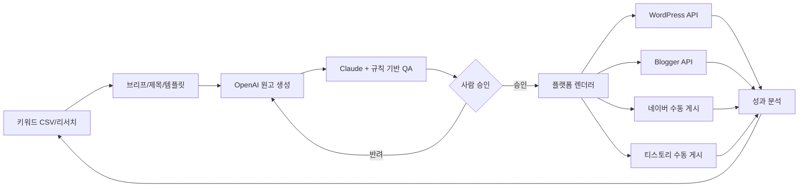

# ContentFlow AI v2.0

> **블로그 콘텐츠 대시보드 — 템플릿 선택·작성·검수·로컬 저장 구현**
>
> 키워드 리서치 → 출처 기반 작성 → AI 교차 검수 → 사람 승인 → 플랫폼별 발행 → 검색/광고 수익 분석

**상태:** 기획 v2.1 + 로컬 프런트엔드 v0.1 (서비스 출시 전) · **최종 정리:** 2026-11-06

**최초 출시 제안:** WordPress 초안 + 티스토리 수동 패키지 · **후속 대상:** Blogger, 네이버, 자체 블로그
**기술 설계:** Next.js · React · TypeScript · Tailwind CSS · shadcn/ui · Supabase/PostgreSQL · n8n · OpenAI API · Claude API · Tiptap (React Flow는 후속)

`apps/web`에 실행 가능한 로컬 대시보드가 있다. 템플릿은 사이드바 메뉴와 콘텐츠 작성 화면에서 선택한다. 서버 인증·AI 생성·CMS·광고 데이터 연결과 설치형 스킨은 후속이다. 기획 정본은 [PRD v2.1](docs/01-planning/PRD.md), 상세 실행안은 [수익화·템플릿 기획](docs/01-planning/MONETIZATION_STRATEGY.md)이다.

## 진행 현황 (2026-11-06 기준)

작업 표 14개 중 10개는 문서/로컬 구현 완료, 2개는 부분 완료(시각 검증·AI 실키 검증), 2개는 모델 확인·로그인/DB 연동 대기다. 작업 항목 기준 약 71%, 서비스 출시 기준 약 30~35%로 어림한다(산정은 [개발 단계와 완성도](docs/07-design/IMPLEMENTATION_STATUS.md)). 화면 시안은 [디자인 시안](docs/07-design/DESIGN_SPEC.md).

| 영역 | 현재 상태 | 제한 사항 |
|---|---|---|
| 대시보드 | 개요·콘텐츠·템플릿·수익 분석·설정, 3구간 CSS | 작성/목록 화면만 스크린샷 확인; 저장된 글 상태·키보드·저장 실패는 미확인 |
| 템플릿 | 10종 카드, 검색/분류, 콘텐츠 화면 선택 | 글쓰기 골격이며 스킨·AI 생성 아님 |
| 키워드·제목 랩 | `/keywords`: CSV 가져오기(중복 건너뜀, 오류 행 보고), 규칙 기반 제목 후보 5개 | 브라우저 저장; 검색량·경쟁도 없음; AI 아님; 키워드→글 연결 없음 |
| 상태 모델 | `lib/lifecycle.ts`: 16단계 전이 규칙, DB enum 일치 테스트. 편집기 진행 패널·목록 5단계 그룹 필터·대시보드에 연결 | 발행 중/발행 실패/초안 생성됨은 "CMS 연동 전"으로 비활성 표시. 게시는 수동 게시 후 운영자 확인 |
| 콘텐츠 | 로컬 생성/수정/검색/삭제, JSON 백업. 저장 키 v2, v1(3단계) 데이터는 읽을 때 자동 변환·원본 보존 | 브라우저 단위 저장, 기기 동기화 없음 |
| 검수/승인 | 검수 요청 시 본문·근거 URL 형식 검사 → 승인 대기 또는 수정 필요, 확인 체크 후 수동 승인 | 사실/권리 자동 검증 아님; 승인·게시 이후라도 내용 변경 시 초안 작성으로 복귀 |
| 내보내기 | 승인 이후 단계 원고만 HTML escape 후 다운로드, 승인 → 내보내기 준비 전환 | 외부 자동 발행·이미지 ZIP 없음 |
| 수익 분석 | 연결 전 안내와 N/A 표시 | 실제 보고서 입력·연동 미구현 |
| Codex 팀 | NOMAD 도구·역할 5종·프로젝트 설정 추가 | 루나-6.1 정확한 ID 대기, 비활성 상태 |
| DB/RLS | `supabase/migrations/0001_core_tenancy.sql` + RLS 테스트. 로컬 Supabase 스택(Docker)에 마이그레이션 적용·8개 테이블 RLS 확인 | 클라우드 프로젝트 없음(로컬 전용). 앱 데이터는 아직 브라우저 저장, 앱-DB 연동·로그인 없음 |
| AI 초안 | `POST /api/ai/generate`: 키워드·템플릿으로 OpenAI 호환 API 호출, 소제목 고정, `[확인 필요]` 표시 | `OPENAI_API_KEY` 설정 시에만 동작. 실제 OpenAI 호출은 미검증(가짜 서버로 검증). 초안은 승인 전 사람이 확인 |
| WordPress | `POST /api/wordpress/draft`: 승인된 글을 **초안으로만** 생성, 재시도 시 같은 초안 갱신, 게시된 글은 덮어쓰지 않음 | 실제 WordPress(Docker) 컨테이너로 생성·갱신·거부 검증. 로그인이 없어 로컬 사용 전제. 게시는 직접 |
| Docker | `Dockerfile`(standalone, non-root), `docker-compose.yml`(읽기 전용 FS, 127.0.0.1 바인딩) | 이미지 327MB, healthcheck 통과 |
| 서버/인증 | API 라우트 + 같은 출처 검사·호출 제한 | 사용자 인증·권한 없음(CF-07b) |

### 작업 진행률

| 작업 묶음 | 완료/전체 | 판단 근거 |
|---|---|---|
| 기획 | 1/1 | PRD·수익화·DB·워크플로우 보강 |
| 로컬 대시보드/편집 | 5/5 | CF-02~04, CF-09~10 코드·테스트·빌드 |
| Docker·연동 | 2/3 | CF-11 Docker·Supabase, CF-13 WordPress 완료 / CF-12 AI는 실키 미검증 |
| DB 스키마 | 1/1 | CF-07a 마이그레이션·RLS 테스트 |
| NOMAD 구성 도구 | 1/1 | CF-05 네이티브 역할·초기화/검사 도구 |
| 모델 활성화/시각 검증/백엔드 연동 | 0/3 | CF-06, CF-07b, CF-08 대기 |

### 구현된 주요 항목

- [x] 대시보드 메뉴와 콘텐츠 현황
- [x] 템플릿 라이브러리 → 콘텐츠 작성 및 편집 화면 내 템플릿 변경
- [x] 로컬 저장·검수·수동 승인·HTML 내보내기
- [x] 16단계 글 상태: 편집기 진행 패널, 목록 5단계 그룹 필터, v1 데이터 자동 변환
- [x] NOMAD Codex 팀 초기화/검사 도구와 5역할 정의

### 다음 개발 단계

- [ ] 부 에이전트의 정확한 모델 ID 확인 후 팀 활성화
- [ ] 실제 브라우저에서 모바일/태블릿/데스크톱 검증
- [ ] Supabase 인증·RLS·서버 저장, WP 초안 API, 수익 보고서 입력

### Docker · Supabase · 연동 실행

| 목적 | 명령/설정 |
|---|---|
| 웹 이미지 빌드·실행 | `docker compose up -d --build` → `http://127.0.0.1:3410` (`WEB_PORT`로 변경) |
| 환경 변수 | `.env.example`을 `.env`로 복사해 채움 (git 제외). 키는 서버에서만 읽음 |
| 로컬 Supabase | `npx supabase start -x realtime,storage-api,imgproxy,edge-runtime,logflare,vector,supavisor` · 포트 60321~ (`supabase/config.toml`), 중지 `npx supabase stop` |
| AI 초안 | `OPENAI_API_KEY`(필수), `OPENAI_MODEL`, `OPENAI_BASE_URL`(호환 API) |
| WordPress | `WP_BASE_URL`(https, 로컬만 http), `WP_USERNAME`, `WP_APP_PASSWORD`(애플리케이션 비밀번호) |
| WordPress 테스트 | `docker compose -f docker-compose.wp-dev.yml up -d` 후 WP-CLI로 설치·비밀번호 발급 |

AI 초안과 WordPress 전송은 승인을 대신하지 않는다. AI 초안의 `[확인 필요]` 표시가 남아 있으면 검수가 차단되고, WordPress에는 승인된 글만 초안으로 전송된다.

## 콘텐츠 바로가기

| 콘텐츠 | 화면 경로 | 기획·명세 문서 | 구현 코드 |
|---|---|---|---|
| 대시보드 | `/` | [PRD](docs/01-planning/PRD.md) | [dashboard](apps/web/src/components/dashboard.tsx) |
| 콘텐츠 목록 | `/content` | [PRD](docs/01-planning/PRD.md) | [content-list](apps/web/src/components/content-list.tsx) |
| 콘텐츠 작성 | `/content/new?template=T02` | [템플릿](docs/04-content/CONTENT_TEMPLATES.md) | [editor](apps/web/src/components/editor.tsx) |
| 저장 원고 편집 | `/content/{id}` | [DB](docs/03-database/DATABASE_SCHEMA.md) | [동적 라우트](apps/web/src/app/content/[id]/page.tsx) |
| 템플릿 라이브러리 | `/templates` | [템플릿](docs/04-content/CONTENT_TEMPLATES.md) | [catalog](apps/web/src/components/catalog.tsx) |
| 수익 분석 | `/analytics` | [수익화 기획](docs/01-planning/MONETIZATION_STRATEGY.md) | [analytics](apps/web/src/components/analytics.tsx) |
| 설정/백업 | `/settings` | [디자인](DESIGN.md) | [settings](apps/web/src/components/settings.tsx) |

[전체 문서](docs/README.md) · [디자인 시안](docs/07-design/DESIGN_SPEC.md) · [개발 단계·완성도](docs/07-design/IMPLEMENTATION_STATUS.md) · [디자인 요약](DESIGN.md) · [구현 현황](tasks/NOW.md)

## 연관·참고 저장소

| 저장소 | 역할 |
|---|---|
| [nomad-agent-os](https://github.com/DevOps0906/nomad-agent-os) | Codex 네이티브 팀 역할·초기화 도구·공통 개발 규칙 |

## 로컬 실행과 검증

| 목적 | 명령/기준 |
|---|---|
| 준비 | Node.js 24, npm 11 |
| 설치 | `npm ci` |
| 개발 | `npm run dev` → `http://127.0.0.1:3000` |
| 타입 검사 | `npm run typecheck` |
| 테스트 | `npm test` — 템플릿/승인 해제/입력/안전한 export/저장 데이터/상태 전이·v1 변환 검증 |
| 배포 빌드 | `npm run build` |
| production 실행 | `npm start` |
| CI | Web checks; Markdown 변경 시 PDF 문서 빌드 |
| 검증 결과 | 타입·테스트 36개·빌드·Docker 이미지 통과; 컨테이너 HTTP 200; 의존성 high 이상 취약점 0 (2026-11-05 감사, 이번 변경은 신규 의존성 없음) |
| 미검증 | 저장된 글이 있는 화면, 키보드 조작, 저장 실패 화면은 브라우저로 확인하지 못함 |

## Codex 멀티에이전트 구성

| 구분 | 설정/상태 |
|---|---|
| 주 에이전트 | `gpt-6.1-sol`, 다음 세션 구성 |
| 부 에이전트 | 요청 `루나-6.1`의 정확한 지원 ID 확인 대기; `gpt-6-luna`로 임의 대체 안 함 |
| 역할 | 탐색·디자인·구현·테스트·리뷰, 최대 동시 부 작업 3개, 깊이 1 |
| 파일 | [.codex/config.toml](.codex/config.toml), [.codex/CODEX_TEAM.md](.codex/CODEX_TEAM.md) |
| 활성화 | NOMAD에서 `nomad-os codex init <프로젝트> --worker-model <확인된_ID>` |
| 실제 실행 | 이번 작업에서 하위 에이전트 실행 없음. 모델 확인 전 비활성 |

## 1. 프로젝트 소개
ContentFlow AI는 단순한 글 자동 생성기를 넘어, **블로그 콘텐츠를 검색 유입과 수익으로 연결하는 운영 플랫폼**이다. 하나의 키워드와 검증된 근거를 바탕으로 **채널별 특성이 다른 독립 콘텐츠 버전**을 작성하며, 사람이 승인한 결과물만 발행한다. 애드센스·애드포스트·제휴 수익과 API/제작비를 함께 분석한다.

### 문제
- 키워드 조사, 제목 작성, 출처 검증, 편집 및 발행이 분산되어 있다.
- 플랫폼별 제목/본문 패턴과 발행 인터페이스가 다르다.
- 대량 AI 작성 시 근거 부족·중복·정책 위반 위험이 있다.
- 글 수만 추적하고 귀속 가능한 유입·수익과 제작 원가를 함께 보지 못한다.

### 해결
**Keyword Explorer → Title Lab → Template Builder → AI Writer → QA Center → Approval → Channel Publisher → Analytics**

## 2. 원칙 및 경계
1. **검증을 우선**: 핵심 주장과 공식 출처/확인일 연결. AI 검수만으로 사실 판정 금지.
2. **수익 주장 검증**: 광고 수익 보장 금지. CPC·RPM 수치와 실측/가정을 구분.
3. **원본성**: 다른 블로그의 고유 문장/디자인 복사 금지. 이용자 경험, 실험, 원본 데이터를 활용.
4. **최종 승인**: MVP는 사람의 승인 없이 외부 발행하지 않는다.
5. **합법적 API**: WordPress REST API/Blogger API는 승인 후 연동, 티스토리·네이버는 HTML/에셋 발행 패키지와 수동 게시.
6. **보안**: 멀티테넌트 RLS, 비밀 토큰 서버 측 관리, 권한별 접근제어.

## 3. 주요 기능
| 모듈 | MVP | 확장 |
|---|---|---|
| 키워드/클러스터 | CSV 입력, 의도/우선순위, 중복 검사 | 검색량·계절성 자동 수집 |
| 제목 생성 | 검색형/홈판형/비교형 제목 5개, 평가 | 게시 전후 제목 실험 |
| 콘텐츠 템플릿 | 정보/오류 해결/비교 3종, 표시·광고 후보 프로필 | 나머지 7종, 설치형 스킨, 비주얼 빌더 |
| AI 콘텐츠 | OpenAI 초안, Claude 리뷰, 비용 로깅 | 모델 라우팅·다국어 |
| 검수 | 사실/출처/권리/광고/중복 게이트 | 변경 감시·시맨틱 중복 |
| 발행 | WP API 초안, 티스토리 수동 패키지, 공개 URL 확인 | Blogger API, 네이버, 자체 CMS/예약 |
| 광고 준비 | 사이트/광고 상태·근거·다음 작업 | 설정 자동 적용/복구 |
| 분석 | 검색/광고 CSV, 비용, 귀속/정산 구분, 개선 큐 | OAuth/API 동기화, 효과 실험 |
| 운영 | 조직/블로그/권한 | 결제, 크레딧, 대행사 |

## 4. 콘텐츠 전략
- **네이버 검색형**: 명확한 문제·대상·경험/출처.
- **네이버 홈판형**: 독자 관심과 실제 사례/시각 자료 중심. 허위 경험 금지.
- **티스토리**: 해결형·롱테일·FAQ·단계별 이미지, 발행 수동.
- **WordPress/Blogger**: 검색 의도, 전문 가이드, 독립 도메인, 내부 링크/기술 SEO.
- **GEO**: 독창적 자료, 엔티티의 명확한 설명, 출처와 갱신일. 노출 보장은 불가.

## 5. 시스템 흐름
다음은 후속 채널까지 포함한 목표 구조다. 최초 출시는 WordPress 초안과 티스토리 패키지로 제한한다.

## 6. 저장소 문서
| 분류 | Markdown 원본 | PDF 배포본 |
|---|---|---|
| 제품 기획 | [PRD](docs/01-planning/PRD.md) | [PRD.pdf](docs/01-planning/PRD.pdf) |
| 수익화 실행 기획 | [MONETIZATION_STRATEGY](docs/01-planning/MONETIZATION_STRATEGY.md) | 다음 문서 빌드에서 생성 |
| 기술 설계 | [SYSTEM_ARCHITECTURE](docs/02-architecture/SYSTEM_ARCHITECTURE.md) | [PDF](docs/02-architecture/SYSTEM_ARCHITECTURE.pdf) |
| DB | [DATABASE_SCHEMA](docs/03-database/DATABASE_SCHEMA.md) | [PDF](docs/03-database/DATABASE_SCHEMA.pdf) |
| 콘텐츠 | [CONTENT_TEMPLATES](docs/04-content/CONTENT_TEMPLATES.md) | [PDF](docs/04-content/CONTENT_TEMPLATES.pdf) |
| 개발 에이전트 | [AGENTS](docs/05-agents/AGENTS.md) | [PDF](docs/05-agents/AGENTS.pdf) |
| 자동화 | [WORKFLOWS](docs/06-workflows/WORKFLOWS.md) | [PDF](docs/06-workflows/WORKFLOWS.pdf) |
| 디자인 시안 | [DESIGN_SPEC](docs/07-design/DESIGN_SPEC.md) | 다음 문서 빌드에서 생성 |
| 개발 단계·완성도 | [IMPLEMENTATION_STATUS](docs/07-design/IMPLEMENTATION_STATUS.md) | 다음 문서 빌드에서 생성 |

> Markdown이 최신 원본이다. 기존 PDF에는 v2.1 보강이 아직 반영되지 않았으며, main/master 반영 후 GitHub Actions 문서 빌드에서 재생성한다.

## 7. 개발 순서 및 Done 기준
1. **Foundation:** Next.js 로그인·Supabase 마이그레이션·RLS 교차 테넌트 차단 테스트.
2. **Content MVP:** CSV 입력, T01/T02/T04, 제목/원고/QA, 표시·광고 후보 프로필, 승인 버전 기록.
3. **Publisher:** WordPress 초안 API, 티스토리 HTML/이미지 패키지, 사람이 게시 후 공개 URL 확인.
4. **Analytics:** 출처별 보고서 CSV·원가·URL 매핑·개선 큐. 관측 예상 수익/확정 정산/모델 가정 분리.
5. **Pilot → SaaS:** 3~5명 파일럿 제안, 편집 시간·반복 사용 검증 후 채널/API/결제 확장.

`docs/` 문서는 제품 의사결정의 기준이며, 실행 코드/비밀키/원본 유료 PDF는 포함하지 않는다.

## 8. 참조·권리
2026년 블로그 운영 PDF 16개와 관리용 XLSX 1개에서 **개념·운영 흐름만 추출**해 독자적으로 작성한 명세이다. 원본 전자책/유료 스킨은 재배포하지 않는다. 블로그 규칙과 API는 배포 시점의 공식 문서로 재확인한다.
