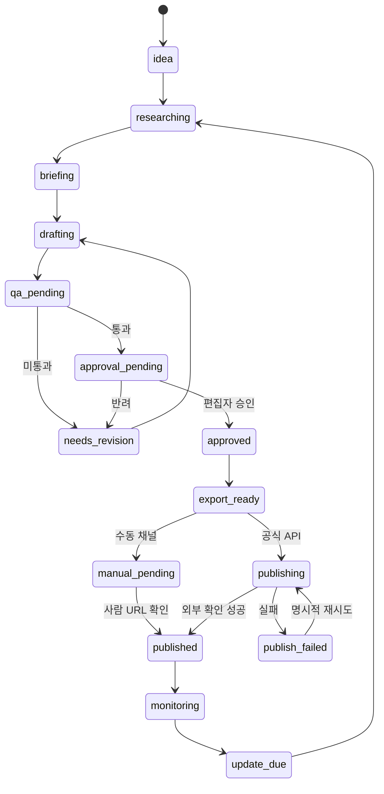

# PRD — ContentFlow AI v2.0
**버전:** 2.0 · **상태:** 계획/구현 전 · **기준일:** 2026-11-05

## 1. 목적과 문제
키워드-제목-원고-검수-발행-분석이 분절된 블로그 운영을 하나의 작업 공간에서 처리한다. AI 글쓰기와 애드센스/애드포스트 수익화를 연결하되, 검색 순위·승인·광고 수익을 보장하지 않는다.

## 2. 사용자와 JTBD
- **Solo Operator:** 1~5개 블로그의 콘텐츠 제작/발행 상태 관리.
- **Editor/Reviewer:** 근거 검증, 원고 수정, 승인/반려.
- **Agency:** 고객 블로그, 운영 권한, 비용/진행 상황 보고.
- **Admin:** 템플릿, 모델 예산, 채널 연결과 감사 로그 관리.

## 3. 콘텐츠 수명주기

**불변식:** 승인 이전 발행 금지, 동일 작업의 중복 게시 금지, 외부 발행 성공은 반환된 URL/ID 확인으로만 기록.

## 4. MVP 기능 및 인수 조건
| ID | 기능 | 검증 가능한 완료 기준 |
|---|---|---|
| P0-01 | 키워드 CSV | 중복 입력 방지, 실패 행 보고, 샘플 30개 수입 |
| P0-02 | 키워드 브리프 | 목적, 대상, 근거 URL, 발행 채널 필수 |
| P0-03 | Title Lab | 제목 5개, 검색 의도/과장/명확성 평가 저장 |
| P0-04 | 10종 템플릿 | 블록 순서·필수 근거·플랫폼 변환 규칙 지원 |
| P0-05 | AI Writer | 모델·프롬프트 버전·토큰·예상 비용 기록 |
| P0-06 | QA Center | 주장 근거 없음/권리 문제 시 무조건 보류 |
| P0-07 | 승인 | 담당자/시각/버전 기록, 승인 후 수정 시 재승인 |
| P0-08 | Publishing | WP/Blogger 승인 후 초안 또는 예약; 네이버/티스토리 수동 패키지 |
| P0-09 | 관측 | 실패 유형·시도 횟수·발행 URL·작업 시간 로그 |
| P0-10 | 보안 | Supabase RLS와 역할/비밀키 분리 통과 |

## 5. UI 화면
Overview(콘텐츠 상태/KPI), Keyword Explorer(클러스터/시즌), Title Lab(후보 비교), Template Builder(블록), Article Editor(Tiptap), QA Center(주장/출처), Publishing Queue(채널/작업), Analytics(검색/매출), Settings(권한/모델/예산).

## 6. 10종 콘텐츠
검색 정보 / 오류 해결 / 정부 혜택 / 가격 비교 / 실사용 후기 / 네이버 홈판 / 쇼핑 제휴 / 이슈 시즌 / 전문 튜토리얼 / GEO 리서치. 템플릿 스키마는 `../04-content/CONTENT_TEMPLATES.md` 참고.

## 7. 운영 정책
- 법률·의료·금융·정부지원 글: 공식 자료와 확인일 없으면 게시 보류.
- 실제 후기: 실제 경험·증빙 없이 작성 금지.
- 제휴: 관계·경제적 대가 고지.
- 이미지: 사용 허가/제작 근거 기록. 저작권 보호 원본 자료 무단 재배포 금지.
- 제목: 본문과 일치, 불필요한 과장·키워드 반복 금지.
- 발행: 플랫폼 공식 API와 지원 범위를 준수.

## 8. KPI
Activation(첫 글 발행), 게시 승인율, 재검수율, 글당 편집 시간, 성공 발행률, 색인율, 검색 클릭·CTR, 페이지 RPM(실측), 글당 비용/ROI, 고객 재방문. 실측/추정 필드 분리.

## 9. 비목표
검색 순위 보장, 애드센스 승인 보장, 허위 방문/클릭, 계정 제재 우회, 무인 대량 콘텐츠 스팸, 무허가 유료 테마 복제.

## 10. 릴리스
M0 보안/DB → M1 키워드·템플릿·글쓰기 → M2 QA/승인 → M3 공식 API·수동 채널 → M4 성과 분석 → M5 SaaS. 각 단계는 자동 테스트와 운영자 시나리오 확인 후 다음 단계 진입.
