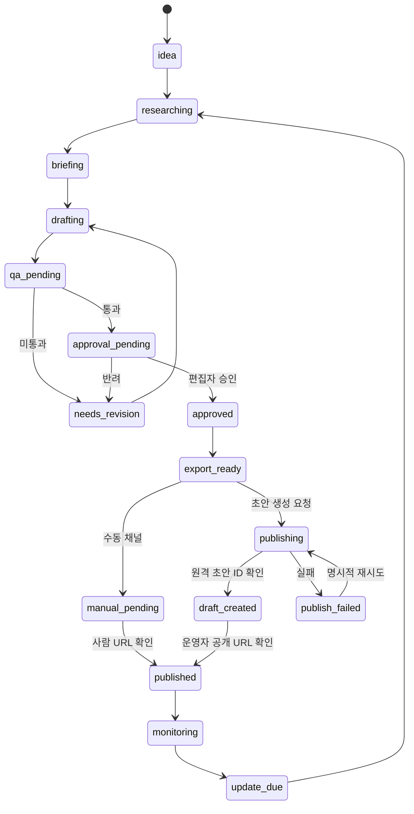

# PRD — ContentFlow AI v2.1
**버전:** 2.1 · **상태:** 계획/구현 전 · **기준일:** 2026-11-05

**로컬 구현 현황:** 사용자 후속 요청으로 `apps/web` 대시보드, 10종 템플릿 선택, 콘텐츠 편집/로컬 저장/수동 승인/HTML export를 구현했다. 아래 서비스 MVP 3종 우선순위와 달리 로컬 골격 선택은 10종 모두 제공한다. 서버 인증·CMS·AI·광고 연동은 여전히 미구현이다. 구현 상태는 [작업 현황](../../tasks/README.md)을 따른다.

v2.1은 최초 출시 범위를 좁힌 기획 보강안이다. 제품명은 ContentFlow AI v2.0을 유지한다. 상세 근거·정책 출처·백로그는 [수익화·템플릿 실행 기획](MONETIZATION_STRATEGY.md)을 따른다. 아래 MVP 범위는 기존 v2.0의 다채널 동시 구현 계획보다 우선한다.

## 1. 목적과 문제
키워드-제목-원고-검수-발행-분석이 분절된 블로그 운영을 하나의 작업 공간에서 처리한다. AI 글쓰기와 애드센스/애드포스트 수익화를 연결하되, 검색 순위·승인·광고 수익을 보장하지 않는다.

## 2. 사용자와 JTBD
- **Solo Operator:** 1~5개 블로그의 콘텐츠 제작/발행 상태 관리.
- **Editor/Reviewer:** 근거 검증, 원고 수정, 승인/반려.
- **Agency:** 고객 블로그, 운영 권한, 비용/진행 상황 보고.
- **Admin:** 템플릿, 모델 예산, 채널 연결과 감사 로그 관리.

최초 검증 대상은 WordPress 블로그 1~3개를 운영하는 개인 운영자다. Reviewer는 겸임할 수 있으며 Agency 기능/결제는 후속이다. 검증할 가치는 편집 시간 절감, 근거 품질, 개선할 글을 선택하는 의사결정이다.

## 3. 콘텐츠 수명주기

**불변식:** 승인 이전 발행 금지, 동일 작업의 중복 게시 금지, 외부 발행 성공은 반환된 URL/ID 확인으로만 기록.

## 4. MVP 기능 및 인수 조건
| ID | 기능 | 검증 가능한 완료 기준 |
|---|---|---|
| P0-01 | 키워드 CSV | 중복 입력 방지, 실패 행 보고, 샘플 30개 수입 |
| P0-02 | 키워드 브리프 | 목적, 대상, 근거 URL, 발행 채널 필수 |
| P0-03 | Title Lab | 제목 5개, 검색 의도/과장/명확성 평가 저장 |
| P0-04 | 3종 템플릿 | T01/T02/T04 블록·근거·예제·버전 고정; 나머지 7종은 후속 |
| P0-05 | AI Writer | 모델·프롬프트 버전·토큰·예상 비용 기록 |
| P0-06 | QA Center | 주장 근거 없음/권리 문제 시 무조건 보류 |
| P0-07 | 승인 | 담당자/시각/버전 기록, 승인 후 수정 시 재승인 |
| P0-08 | Publishing | WP 승인 후 초안 생성; 운영자 게시/공개 URL 확인. 티스토리 수동 패키지. Blogger API/예약/네이버는 후속 |
| P0-09 | 관측 | 실패 유형·시도 횟수·발행 URL·작업 시간 로그 |
| P0-10 | 보안 | Supabase RLS와 역할/비밀키 분리 통과 |
| P0-11 | 사이트 준비 점검 | 항목별 상태·근거·확인 시각; 광고 상태와 콘텐츠 상태 분리 |
| P0-12 | 표시/광고 프로필 | L01/L02, A00/A01 버전과 미리보기; 광고 script 자동 삽입 없음 |
| P0-13 | 수익/원가 입력 | 출처별 검증 CSV, 통화/시간대/기간/정산 상태 보존, 재수입 중복 방지 |
| P0-14 | 개선 큐 | 관측 근거·대상 URL·담당자·변경 버전·검토 기한 기록 |

자동 발행 기능은 후속이다. WP 초안 생성 성공만으로 글을 published 처리하지 않으며, 공개 URL 확인 뒤 전이한다. 광고 준비 미완료는 일반 콘텐츠 발행의 차단 사유가 아니다.

## 5. UI 화면
Overview(콘텐츠 상태/KPI), Keyword Explorer(클러스터/시즌), Title Lab(후보 비교), Template Builder(블록), Article Editor(Tiptap), QA Center(주장/출처), Publishing Queue(채널/작업), Analytics(검색/매출), Settings(권한/모델/예산).

MVP는 Overview(다음 작업/연결 상태), Onboarding(사이트·광고 준비), Article Editor(3종 선택/제목/검수/승인), Publishing Queue, Analytics(보고서/비용/개선 큐), Settings로 묶는다. 독립 Keyword Explorer·Title Lab·비주얼 Template Builder는 후속이며 CSV/제목 후보 기능은 편집 화면에서 제공한다.

## 6. 10종 콘텐츠
전체 카탈로그는 검색 정보 / 오류 해결 / 정부 혜택 / 가격 비교 / 실사용 후기 / 네이버 홈판 / 쇼핑 제휴 / 이슈 시즌 / 전문 튜토리얼 / GEO 리서치다. 최초 구현은 T01/T02/T04로 한정한다. [템플릿 계약](../04-content/CONTENT_TEMPLATES.md)을 참고한다. 글쓰기 구조, 사이트 표시, 광고 배치는 별도 계층이며 설치 가능한 스킨은 아직 없다.

## 7. 운영 정책
- 법률·의료·금융·정부지원 글: 공식 자료와 확인일 없으면 게시 보류.
- 실제 후기: 실제 경험·증빙 없이 작성 금지.
- 제휴: 관계·경제적 대가 고지.
- 이미지: 사용 허가/제작 근거 기록. 저작권 보호 원본 자료 무단 재배포 금지.
- 제목: 본문과 일치, 불필요한 과장·키워드 반복 금지.
- 발행: 플랫폼 공식 API와 지원 범위를 준수.

## 8. KPI
핵심 KPI는 7일 내 첫 공개 글 확인, 글당 편집 시간, 주간 개선 큐 사용이다. 보조 지표는 검수 반려/재검수, 초안 전달 성공률, 검색 클릭·CTR, 페이지 RPM, 귀속 가능한 수익과 원가다. 색인율은 검사한 URL의 분모와 확인 방식을 명시한다.

페이지 RPM은 동일 AdSense 보고서의 예상 수익과 PAGE_VIEWS로 계산한다. `provenance`와 `value_status`를 분리하여 API 관측 예상 수익/정산 확정/모델 추정을 구분한다. 페이지 귀속 불가 시 글별 ROI는 N/A다. 데이터 미연결은 0원으로 채우지 않는다. 수익 증가와 광고 승인 여부는 초기 출시 통과 기준이 아니다.

## 9. 비목표
검색 순위 보장, 애드센스 승인 보장, 허위 방문/클릭, 계정 제재 우회, 무인 대량 콘텐츠 스팸, 무허가 유료 테마 복제.

## 10. 릴리스
M0 보안/DB → M1 3종 제작·QA·승인 → M2 WP 초안·티스토리 패키지 → M3 CSV 성과·원가·개선 큐 → M4 파일럿 → M5 API 수집·채널·템플릿·SaaS 확장. 단계별 게이트는 실행 기획 8절을 따른다.

## 11. 필수 부정 시나리오

- 광고 상태 미확인/제한 중에도 콘텐츠 편집과 export는 가능하다.
- 전달 후 원격 초안만 존재하면 `draft_created`이며 공개 확인 전 `published`가 아니다.
- 글/표시/광고/renderer 버전 중 하나라도 바뀌면 기존 승인을 새 산출물에 재사용하지 않는다.
- 임의 script·이벤트 속성·허위 근거가 있는 HTML은 전달을 차단한다.
- 동일 보고서 재수입, 사이트 총액과 페이지 합계, 월 정산과 일별 예상 수익을 중복 합산하지 않는다.
- GA4 조회수와 AdSense 수익을 섞어 공식 페이지 RPM처럼 표시하지 않는다.
