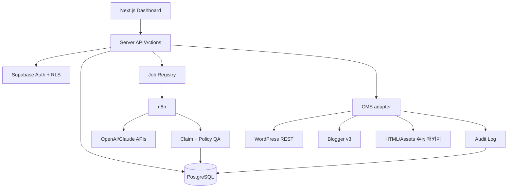

# System Architecture — ContentFlow AI
**상태:** 설계안

## 1. 스택 및 책임
Next.js App Router/TypeScript, Tailwind/shadcn/ui, Tiptap, React Flow; Supabase Auth/PostgreSQL/Storage/RLS; n8n(오케스트레이션); OpenAI API(구조화 작성), Claude API(보조 검토); WordPress REST/Blogger v3 연동.

## 2. 경계와 연결


## 3. 출처 및 자료
PDF/공식 문서/경험 자료 → 안전한 저장소 → 출처 인덱스 → 주장(claim)-근거(source) 매핑. 단순 AI 모델 간 합의는 검증이 아니다. 주장을 URL, 인용 위치, 확인 시각으로 추적.

## 4. 핵심 데이터 흐름
1. CSV 업로드에서 행 검증 및 동일 workspace 내 중복 키 검사.
2. keyword → brief → title candidates → article version → source claims.
3. AI 실행: 모델 지정, 예산 검사, idempotency key, 구조화 출력 JSON schema 검사.
4. 독립 QA: 출처 누락/법률·금융 위험/부적절한 광고 문구/반복 콘텐츠 검사.
5. 사람의 승인된 특정 article_version만 immutable snapshot으로 publisher에 전달.
6. API 응답과 published URL/ID 저장; 수동 경로는 운영자가 URL 검증.
7. Search Console/GA4/매출 데이터는 일자와 출처별 적재. 실제 수익·추정값 분리.

## 5. CMS Adapter 계약
```text
capabilities(): {supportsDraft, supportsSchedule, supportsUpdate, requiresManual}
validate(articleVariant): ValidationResult
prepare(articleVariant): PublishPayload
publish(approvedSnapshot, idempotencyKey): PublishResult
verify(result): VerifiedResult
```
- WordPress: REST API 글 상태 draft/future/publish, 최소 권한 자격증명.
- Blogger: Blogger API OAuth, draft/publish 지원 범위 재검증.
- Tistory/Naver: 플랫폼 공식 글쓰기 API를 가정하지 않음. HTML+이미지+태그를 만든 뒤 수동 발행.
- 자체 사이트: 추후 별도 adapter.
- 재시도: 429/5xx 지수 백오프, 인증 401/403 자동 재시도 금지, 불명확한 응답은 원격 중복 확인.

## 6. 운영 보안
서버 전용 토큰/Secret Manager; service_role 프런트 노출 금지; RLS workspace 격리; OAuth 최소 scope; 연결 폐기; 발행 감사 기록; 외부 API 데이터 전달에 대한 정책·기밀 검토.

## 7. 배포
웹: Vercel 또는 동일 Next.js 호스트; DB/Storage: Supabase; n8n/worker: 별도 Docker 기반 서비스. 웹 요청 안에서 장시간 모델 작업 실행 금지. 작업 큐/상태/재실행으로 관리.

## 8. 운영 성능 기준
발행 요청 중복 0건(멱등성), 템플릿 버전별 재현 가능, RLS 교차 테넌트 테스트 전부 통과, 장애 복구·감사 로그, 일일 모델 예산·경보, 오류 상태 대시보드.
