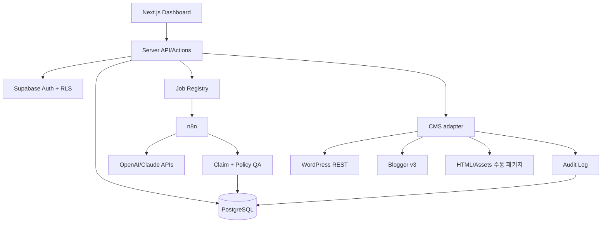

# System Architecture — ContentFlow AI
**상태:** 설계안

**v2.1 범위:** [PRD](../01-planning/PRD.md)의 축소 MVP가 아래 전체 목표 구조보다 우선한다. 첫 출시는 WP 초안/티스토리 export, 3종 템플릿, CSV 분석이다. Blogger/API 성과 수집/예약은 후속이다.

## 1. 스택 및 책임
Next.js App Router/TypeScript, Tailwind/shadcn/ui, Tiptap, React Flow; Supabase Auth/PostgreSQL/Storage/RLS; n8n(오케스트레이션); OpenAI API(구조화 작성), Claude API(보조 검토); WordPress REST/Blogger v3 연동.

## 2. 경계와 연결


## 3. 출처 및 자료
PDF/공식 문서/경험 자료 → 안전한 저장소 → 출처 인덱스 → 주장(claim)-근거(source) 매핑. 단순 AI 모델 간 합의는 검증이 아니다. 주장을 URL, 인용 위치, 확인 시각으로 추적.

## 4. 핵심 데이터 흐름
1. CSV 업로드에서 행 검증 및 동일 workspace 내 중복 키 검사.
2. keyword → brief → title candidates → article version → source claims.
3. AI 실행: 모델 지정, 예산 검사, idempotency key, 구조화 출력 JSON schema 검사.
4. 독립 QA: 출처 누락/법률·금융 위험/부적절한 광고 문구/반복 콘텐츠 검사.
5. 사람의 승인된 특정 article_version만 immutable snapshot으로 publisher에 전달.
6. API 응답과 published URL/ID 저장; 수동 경로는 운영자가 URL 검증.
7. Search Console/GA4/매출 데이터는 일자와 출처별 적재. 실제 수익·추정값 분리.

## 5. CMS Adapter 계약
```text
capabilities(): {supportsDraft, supportsSchedule, supportsUpdate, requiresManual}
validate(articleVariant): ValidationResult
prepare(articleVariant): PublishPayload
publish(approvedSnapshot, idempotencyKey): PublishResult
verify(result): VerifiedResult
```
- WordPress: REST API 글 상태 draft/future/publish, 최소 권한 자격증명.
- Blogger: Blogger API OAuth, draft/publish 지원 범위 재검증.
- Tistory/Naver: 플랫폼 공식 글쓰기 API를 가정하지 않음. HTML+이미지+태그를 만든 뒤 수동 발행.
- 자체 사이트: 추후 별도 adapter.
- 재시도: 429/5xx 지수 백오프, 인증 401/403 자동 재시도 금지, 불명확한 응답은 원격 중복 확인.

## 6. 운영 보안
서버 전용 토큰/Secret Manager; service_role 프런트 노출 금지; RLS workspace 격리; OAuth 최소 scope; 연결 폐기; 발행 감사 기록; 외부 API 데이터 전달에 대한 정책·기밀 검토.

## 7. 배포
웹: Vercel 또는 동일 Next.js 호스트; DB/Storage: Supabase; n8n/worker: 별도 Docker 기반 서비스. 웹 요청 안에서 장시간 모델 작업 실행 금지. 작업 큐/상태/재실행으로 관리.

**현재 구현(2026-11-06):** 웹은 루트 Dockerfile(Next standalone, non-root)과 docker-compose.yml(읽기 전용 FS, 127.0.0.1 바인딩)로 실행한다. DB는
px supabase start의 로컬 스택(포트 60320번대)이며 마이그레이션 0001이 적용돼 있다. AI 초안(/api/ai/generate, 60초 제한)과 WordPress 초안(/api/wordpress/draft)은 웹 API 라우트에서 동기 호출하며, 키는 서버 환경 변수로만 읽는다. 인증이 없으므로 같은 출처 검사와 호출 제한만 적용하고 외부 공개를 금지한다. 큐·n8n·승인 스냅샷은 미구현이다.

## 8. 운영 성능 기준
발행 요청 중복 0건(멱등성), 템플릿 버전별 재현 가능, RLS 교차 테넌트 테스트 전부 통과, 장애 복구·감사 로그, 일일 모델 예산·경보, 오류 상태 대시보드.

## 9. v2.1 템플릿/광고/측정 경계

- Renderer 입력은 승인된 본문 + 고정된 글쓰기/표시/광고 프로필/renderer 버전이다. 미리보기와 export가 같은 renderer를 사용한다. HTML 허용 목록 정제 후 출력하며 임의 script/event handler는 제거 또는 차단한다. 광고 후보 슬롯은 미리보기의 placeholder이며 모델 출력 광고 코드를 실행하지 않는다.
- 승인 해시는 본문/제목뿐 아니라 프로필 버전과 렌더 결과를 포함한다. 변경 시 새 QA/승인이 필요하다. 이전 패키지를 보존하여 복구한다.
- WordPress 어댑터의 초안 생성은 `draft_created`로 기록한다. 공개 게시와 별개이며 운영자의 공개 URL 확인으로 완료한다. 후속 예약은 예약 등록 성공과 실제 공개 확인을 구분한다.
- 사이트 준비 점검/광고 상태는 독립 서비스다. MVP는 설정 기록과 안내만 제공한다. 실제 테마·광고·CMP 적용은 운영자가 수행한다.
- 보고서 입력은 파일 검증 → import batch → 원본/출처/정산 상태 보존 → URL 매핑 → 집계 → 개선 후보 순서다. 외부 URL 점검은 사설/루프백/링크로컬 주소를 차단하고 redirect마다 재검증하여 SSRF를 막는다.
- 데이터 소스마다 시간대/통화/범위/차원/수집 시각을 보존한다. 사이트 총계와 페이지 상세를 별도 집계 경로로 두며 서로 더하지 않는다. 월 확정 정산과 일별 예상 수익도 별도다.
- `PAGE_URL` 지원 여부는 연결 계정에서 검증한다. 정규화 원본과 canonical 매핑을 보존하고 충돌은 수동 검토한다. 미귀속 수익을 조회수 비율로 자동 배분하지 않는다.
- GSC 검색 성과와 색인 검사는 별도 기능이다. API 수집은 후속이며 CSV 업로드 시 0·결측·미지원 상태를 구분한다.
