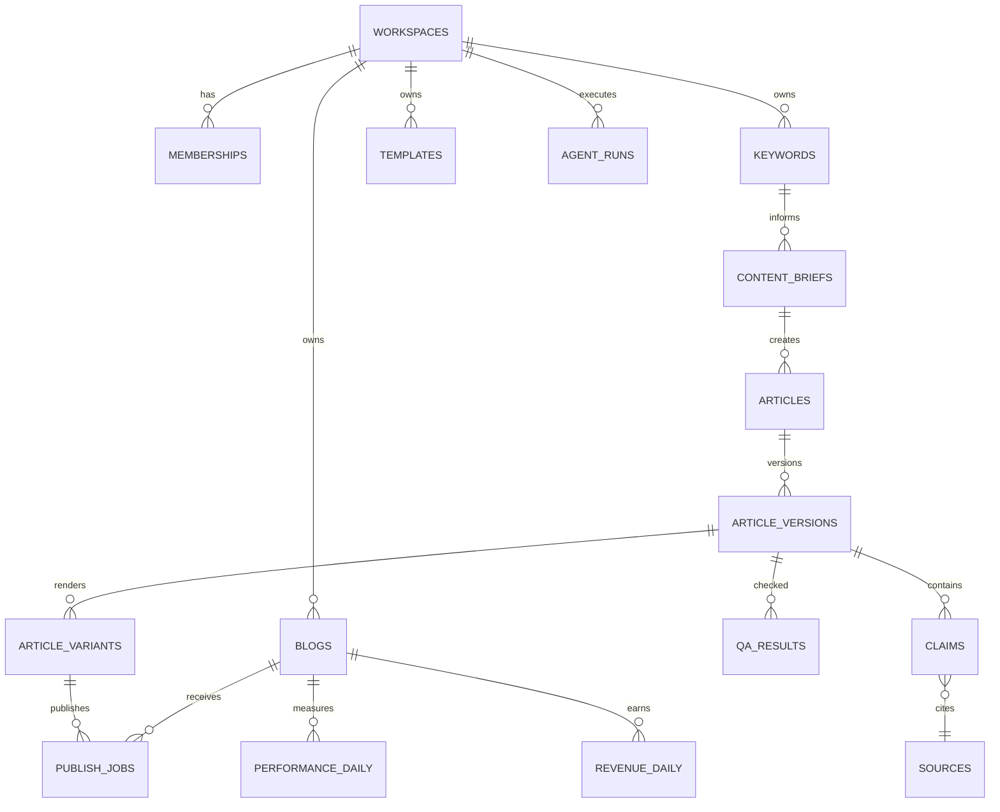

# Database Schema — PostgreSQL / Supabase
**목표:** 멀티테넌트, 감사 가능, 콘텐츠 원본·버전·수익 분리

## 1. 엔티티 관계

## 2. 기본 테이블 계약
| 테이블 | 필수 컬럼 | 제약/설명 |
|---|---|---|
| workspaces | id UUID, name, owner_id, plan | 조직 경계 |
| memberships | workspace_id, user_id, role | UNIQUE(workspace_id,user_id), enum owner/admin/editor/reviewer/viewer |
| blogs | id, workspace_id, platform, domain, status | blog platform enum |
| channel_connections | id, blog_id, credential_ref, scopes, state | **토큰 자체 저장 금지** |
| keywords | id, workspace_id, phrase, locale, intent, priority | 워크스페이스 범위 중복 정책 |
| keyword_clusters | id, workspace_id, label, parent_id | seasonality optional |
| content_briefs | id, keyword_id, template_id, target_audience, status | 근거 필수 |
| templates | id, workspace_id, slug, version, blocks_json | JSON schema validation |
| articles | id, workspace_id, brief_id, owner_id, state | 상태 enum |
| article_versions | id, article_id, version, markdown, title, content_hash | immutable approved snapshots |
| sources | id, workspace_id, url, title, checked_at, license_note | URL uniqueness candidate |
| claims | id, article_version_id, source_id, text, verification_state | 검증 결과 |
| qa_results | id, article_version_id, score, blockers_json, reviewer_id | fail closed |
| article_variants | id, article_version_id, blog_id, title, html, status | 채널별 독립 결과 |
| publish_jobs | id, article_variant_id, blog_id, idempotency_key, state, remote_id, remote_url | UNIQUE(blog_id,idempotency_key) |
| performance_daily | blog_id, article_variant_id?, date, clicks, impressions | 검색 데이터 |
| revenue_daily | blog_id, date, provider, amount, currency, is_estimated | 실측/추정 구분 |
| agent_runs | id, workspace_id, task, model, tokens_in, tokens_out, cost_estimate, status | 모델별 계량 |
| audit_logs | id, workspace_id, actor_id, action, payload, created_at | 보안 감사 |

## 3. 주요 상태 값
Article: idea → researching → briefing → drafting → qa_pending → needs_revision → approval_pending → approved → export_ready → publishing → draft_created → published → monitoring → update_due. 수동 경로는 export_ready → manual_pending → published이며 publishing 실패 시 publish_failed에서 명시적으로 재시도한다.
PublishJob: queued, running, draft_created, manual_pending, succeeded, failed, cancelled, needs_attention. draft_created/manual_pending은 공개 확인 전 상태다.

## 4. RLS 인수 테스트
- Workspace A의 editor는 Workspace B의 글, 출처, 비용 데이터를 읽거나 수정할 수 없다.
- Viewer는 글 승인/발행을 못 한다.
- Reviewer는 QA 검수는 가능하나 관리자 설정/credential_ref 변경 금지.
- service_role은 서버/워커에서만 접근하고 사용자 요청에 직접 사용하지 않는다.
- 모든 외래키는 동일 workspace 경계를 재검증한다.

## 5. 인덱스/운영
- keywords(workspace_id, lower(phrase)); articles(workspace_id, state); publish_jobs(state, scheduled_at).
- 성과: (blog_id, date), (article_variant_id, date) 인덱스 및 원본 데이터 소스 보존.
- 승인 후 내용 변경 시 승인 무효 처리.
- 삭제·개인정보 최소화·보존기간·백업·복원 연습 별도 운영정책으로 관리.

**본 문서는 논리 스키마이며 실행용 SQL migration이 아니다.** 구현 단계에서 SQL/제약/RLS 테스트를 작성한다.

## 6. v2.1 추가·수정 계약

아래 정의가 앞의 기본 테이블에서 같은 필드를 설명한 부분보다 우선한다. 상세 지표/정책은 [수익화 기획](../01-planning/MONETIZATION_STRATEGY.md)을 따른다. 모든 tenant 소유 테이블은 `workspace_id`를 가지며 부모와의 복합 FK 및 RLS로 동일 workspace를 강제한다.

| 테이블 | 주요 필드/변경 | 제약/의미 |
|---|---|---|
| blog_monetization | blog_id, provider, ad_status, provider_status_raw, evidence_ref, checked_at, verification_method | UNIQUE(blog_id,provider); 내부 광고 상태와 콘텐츠 상태 별도 |
| site_check_results | blog_id, check_key, status, severity, evidence_url, checked_by, checked_at, policy_url | status=pass/fail/unknown/not_applicable; severity=blocker/warning/info. 콘텐츠/광고 적용 범위를 별도 필드로 지정 |
| templates | id, workspace_id, slug, version, blocks_json | UNIQUE(workspace_id,slug,version); 사용된 버전 수정 금지 |
| layout_profiles | id, workspace_id, slug, version, platform, config_json, license_note | UNIQUE(workspace_id,slug,version); 실제 스킨 존재 여부는 별도 |
| ad_profiles | id, workspace_id, slug, version, platform, slots_json, config_json | UNIQUE(workspace_id,slug,version); MVP placeholder만, script 저장 안 함 |
| render_bundles | id, workspace_id, article_version_id, template_id, layout_profile_id, ad_profile_id, renderer_version, html_hash, artifact_ref | 각각 버전 고정된 행 참조; 렌더 묶음은 불변 |
| approvals | id, workspace_id, render_bundle_id, reviewer_id, decision, approved_at, snapshot_hash | 정확한 묶음 승인; 최신 승인된 묶음과 일치할 때만 전달 |
| publish_jobs | render_bundle_id, approved_snapshot_hash, operation, remote_status, verified_at, verification_method | operation=create_draft/export; state에 draft_created 추가. remote_status=draft/published/unknown |
| import_batches | id, workspace_id, blog_id, provider, file_hash, report_key, dimensions_json, report_timezone, currency, date_from, date_to, imported_at, status, supersedes_id, coverage | 같은 보고서 범위의 재수입을 버전으로 보존; 유효 batch 하나만 집계 |
| article_url_mappings | id, workspace_id, blog_id, article_variant_id, raw_url, normalized_url, canonical_url, valid_from, valid_to, state | 기간별 동일 정규화 URL의 활성 매핑 하나; 충돌은 review |
| revenue_daily | id, workspace_id, blog_id, article_variant_id?, import_batch_id, date, provider, amount, currency, provenance, value_status, granularity, dimension_key, raw_url?, attribution_status | amount는 decimal; 유효 batch/날짜/차원 키로 중복 방지 |
| revenue_settlements | id, workspace_id, provider_account_ref, period_month, amount, currency, provenance, evidence_ref | 계정/월 정산 보존; 일·글별 예상값에 합산 금지 |
| performance_daily | workspace_id, blog_id, article_variant_id?, import_batch_id, date, provider, metric_scope, dimension_key, clicks?, impressions?, page_views? | GSC/GA4/AdSense 분리, 같은 이름 지표도 출처 보존 |
| cost_entries | id, workspace_id, blog_id?, article_version_id?, agent_run_id?, category, amount, currency, occurred_at, provenance, allocation_method | 모델/노동/호스팅/갱신 구분; agent_run 중복 원가 계상 방지 |
| improvement_tasks | id, workspace_id, blog_id, article_variant_id, reason, evidence_json, baseline_version_id, owner_id, due_at, state, resulting_version_id?, review_at | 추천은 작업 큐; 자동 외부 발행 아님 |

`revenue_daily.is_estimated` 하나로는 부족하다. 대체할 필드:

- `provenance`: api/csv/manual/model. 데이터가 어디서 왔는지 나타낸다.
- `value_status`: provider_estimated/finalized/modeled. 모델 추정은 provenance=model과 일치해야 한다. MVP 일별 AdSense 보고서는 provider_estimated로 저장하고 월 확정은 revenue_settlements로 저장한다.
- `granularity`: site/page. 계정 단위는 별도 계정 보고서/정산 경로로 보존하며 한 blog로 임의 귀속하지 않는다.
- `attribution_status`: matched/unmapped/not_applicable. page 행인데 URL 연결 실패 시 article_variant_id=NULL로 남긴다.
- `dimension_key`: 원본 보고서의 전체 차원 조합을 정규화한 키. 동일 batch/date/key UNIQUE. 사이트 총계와 페이지 상세는 별도 report_key를 사용한다.

보고 범위 일부가 겹칠 때 단순 행 덧셈을 금지한다. 최초 구현은 동일 provider/blog/report_key/시간대/통화의 정확히 같은 기간을 통째로 교체하고, 부분 기간 중첩은 거절 후 동일 기간으로 다시 내보내도록 안내한다. report_key는 차원/필터/지표 집합의 정규화 해시이며 파일 해시와 다르다. 같은 파일 재수입은 기존 결과를 반환한다. 교체 시 트랜잭션으로 이전 batch를 superseded 처리한다.

GSC 클릭·GA4 방문·AdSense PAGE_VIEWS는 별도 지표다. 날짜만으로 합산하지 않는다. 미수집은 nullable 값 및 batch 상태로 표시하고 0원과 구분한다. 여러 통화의 합계는 환율/기준일이 명시된 파생 뷰에서만 제공한다. agent_runs의 예상 비용과 cost_entries에 반영한 비용은 다시 더하지 않는다.

## 7. v2.1 핵심 인수 조건

- 다른 workspace의 프로필/승인/블로그/보고서를 참조하는 FK 입력과 조회가 모두 실패한다.
- 승인 후 render bundle 중 하나가 바뀌면 새 승인을 요구하며 기존 bundle은 보존한다.
- 초안 생성은 콘텐츠 공개 성공으로 집계하지 않는다. 초안 생성 후 운영자 게시 확인까지 pending이다.
- 동일 CSV 재수입은 행수/총액을 늘리지 않고 교체 전 이력은 감사 가능하다.
- 사이트 100원과 해당 페이지 합계 100원을 가져와도 총액은 200원이 되지 않는다.
- API 예상 수익은 확정 정산으로 바뀌지 않으며 미귀속 페이지는 가짜 글별 매출을 만들지 않는다.
