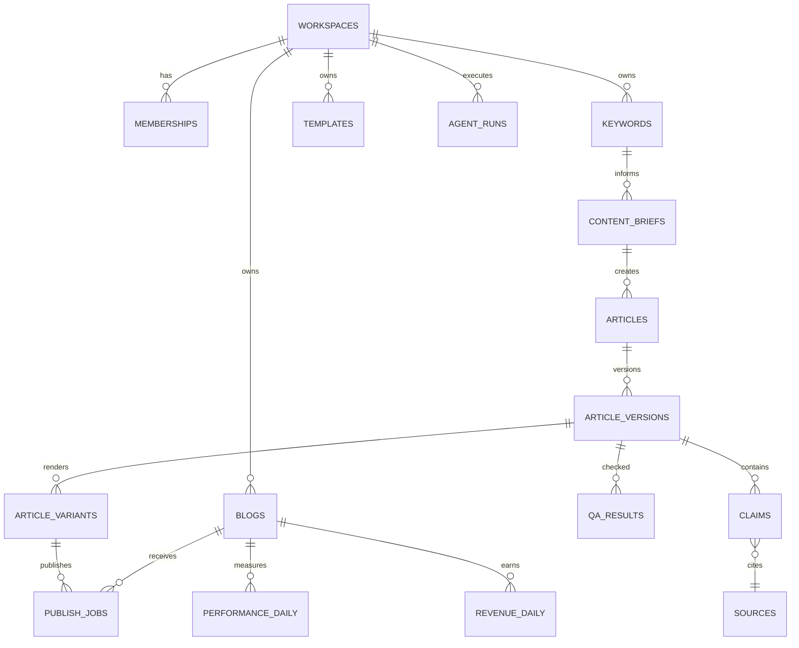

# Database Schema — PostgreSQL / Supabase
**목표:** 멀티테넌트, 감사 가능, 콘텐츠 원본·버전·수익 분리

## 1. 엔티티 관계

## 2. 기본 테이블 계약
| 테이블 | 필수 컬럼 | 제약/설명 |
|---|---|---|
| workspaces | id UUID, name, owner_id, plan | 조직 경계 |
| memberships | workspace_id, user_id, role | UNIQUE(workspace_id,user_id), enum owner/admin/editor/reviewer/viewer |
| blogs | id, workspace_id, platform, domain, status | blog platform enum |
| channel_connections | id, blog_id, credential_ref, scopes, state | **토큰 자체 저장 금지** |
| keywords | id, workspace_id, phrase, locale, intent, priority | 워크스페이스 범위 중복 정책 |
| keyword_clusters | id, workspace_id, label, parent_id | seasonality optional |
| content_briefs | id, keyword_id, template_id, target_audience, status | 근거 필수 |
| templates | id, workspace_id, slug, version, blocks_json | JSON schema validation |
| articles | id, workspace_id, brief_id, owner_id, state | 상태 enum |
| article_versions | id, article_id, version, markdown, title, content_hash | immutable approved snapshots |
| sources | id, workspace_id, url, title, checked_at, license_note | URL uniqueness candidate |
| claims | id, article_version_id, source_id, text, verification_state | 검증 결과 |
| qa_results | id, article_version_id, score, blockers_json, reviewer_id | fail closed |
| article_variants | id, article_version_id, blog_id, title, html, status | 채널별 독립 결과 |
| publish_jobs | id, article_variant_id, blog_id, idempotency_key, state, remote_id, remote_url | UNIQUE(blog_id,idempotency_key) |
| performance_daily | blog_id, article_variant_id?, date, clicks, impressions | 검색 데이터 |
| revenue_daily | blog_id, date, provider, amount, currency, is_estimated | 실측/추정 구분 |
| agent_runs | id, workspace_id, task, model, tokens_in, tokens_out, cost_estimate, status | 모델별 계량 |
| audit_logs | id, workspace_id, actor_id, action, payload, created_at | 보안 감사 |

> **적용 상태:** `0001_core_tenancy.sql`(코어·RLS)과 `0002_article_content_and_state_rules.sql`이 로컬 Supabase에 적용되어 있고 8개 테이블에 RLS가 켜져 있다. 앱은 로그인 시 이 DB에 글을 저장한다. 클라우드 프로젝트는 없다.
>
> **0002 요약:** `articles`에 작업본 컬럼(title, keyword, template_id, platform, body, source_url, remote)을 추가하고, `enforce_article_rules` 트리거로 (1) 신규 글은 기획 단계에서만 시작, (2) 상태 전이는 `article_transition_allowed` 표에 있는 것만 허용(앱 `lifecycle.ts`와 일치 테스트로 묶음), (3) 내용을 고치면 승인·게시 상태가 `drafting`으로 복귀하지 않는 저장은 거부, (4) 검수·승인 이후 상태는 제목·본문·http(s) 근거·AI 표시 해소를 요구, (5) `approved` 전환 시 owner/admin/reviewer만 가능하며 버전 스냅샷·승인·감사 로그를 같은 트랜잭션에 기록, (6) workspace·owner 변경 금지. 테스트: `supabase/tests/rls.sql`.

## 3. 주요 상태 값
Article: idea → researching → briefing → drafting → qa_pending → needs_revision → approval_pending → approved → export_ready → publishing → draft_created → published → monitoring → update_due. 수동 경로는 export_ready → manual_pending → published이며 publishing 실패 시 publish_failed에서 명시적으로 재시도한다.
PublishJob: queued, running, draft_created, manual_pending, succeeded, failed, cancelled, needs_attention. draft_created/manual_pending은 공개 확인 전 상태다.

## 4. RLS 인수 테스트
- Workspace A의 editor는 Workspace B의 글, 출처, 비용 데이터를 읽거나 수정할 수 없다.
- Viewer는 글 승인/발행을 못 한다.
- Reviewer는 QA 검수는 가능하나 관리자 설정/credential_ref 변경 금지.
- service_role은 서버/워커에서만 접근하고 사용자 요청에 직접 사용하지 않는다.
- 모든 외래키는 동일 workspace 경계를 재검증한다.

## 5. 인덱스/운영
- keywords(workspace_id, lower(phrase)); articles(workspace_id, state); publish_jobs(state, scheduled_at).
- 성과: (blog_id, date), (article_variant_id, date) 인덱스 및 원본 데이터 소스 보존.
- 승인 후 내용 변경 시 승인 무효 처리.
- 삭제·개인정보 최소화·보존기간·백업·복원 연습 별도 운영정책으로 관리.

**본 문서는 논리 스키마이며 실행용 SQL migration이 아니다.** 구현 단계에서 SQL/제약/RLS 테스트를 작성한다.

## 6. v2.1 추가·수정 계약

아래 정의가 앞의 기본 테이블에서 같은 필드를 설명한 부분보다 우선한다. 상세 지표/정책은 [수익화 기획](../01-planning/MONETIZATION_STRATEGY.md)을 따른다. 모든 tenant 소유 테이블은 `workspace_id`를 가지며 부모와의 복합 FK 및 RLS로 동일 workspace를 강제한다.

| 테이블 | 주요 필드/변경 | 제약/의미 |
|---|---|---|
| blog_monetization | blog_id, provider, ad_status, provider_status_raw, evidence_ref, checked_at, verification_method | UNIQUE(blog_id,provider); 내부 광고 상태와 콘텐츠 상태 별도 |
| site_check_results | blog_id, check_key, status, severity, evidence_url, checked_by, checked_at, policy_url | status=pass/fail/unknown/not_applicable; severity=blocker/warning/info. 콘텐츠/광고 적용 범위를 별도 필드로 지정 |
| templates | id, workspace_id, slug, version, blocks_json | UNIQUE(workspace_id,slug,version); 사용된 버전 수정 금지 |
| layout_profiles | id, workspace_id, slug, version, platform, config_json, license_note | UNIQUE(workspace_id,slug,version); 실제 스킨 존재 여부는 별도 |
| ad_profiles | id, workspace_id, slug, version, platform, slots_json, config_json | UNIQUE(workspace_id,slug,version); MVP placeholder만, script 저장 안 함 |
| render_bundles | id, workspace_id, article_version_id, template_id, layout_profile_id, ad_profile_id, renderer_version, html_hash, artifact_ref | 각각 버전 고정된 행 참조; 렌더 묶음은 불변 |
| approvals | id, workspace_id, render_bundle_id, reviewer_id, decision, approved_at, snapshot_hash | 정확한 묶음 승인; 최신 승인된 묶음과 일치할 때만 전달 |
| publish_jobs | render_bundle_id, approved_snapshot_hash, operation, remote_status, verified_at, verification_method | operation=create_draft/export; state에 draft_created 추가. remote_status=draft/published/unknown |
| import_batches | id, workspace_id, blog_id, provider, file_hash, report_key, dimensions_json, report_timezone, currency, date_from, date_to, imported_at, status, supersedes_id, coverage | 같은 보고서 범위의 재수입을 버전으로 보존; 유효 batch 하나만 집계 |
| article_url_mappings | id, workspace_id, blog_id, article_variant_id, raw_url, normalized_url, canonical_url, valid_from, valid_to, state | 기간별 동일 정규화 URL의 활성 매핑 하나; 충돌은 review |
| revenue_daily | id, workspace_id, blog_id, article_variant_id?, import_batch_id, date, provider, amount, currency, provenance, value_status, granularity, dimension_key, raw_url?, attribution_status | amount는 decimal; 유효 batch/날짜/차원 키로 중복 방지 |
| revenue_settlements | id, workspace_id, provider_account_ref, period_month, amount, currency, provenance, evidence_ref | 계정/월 정산 보존; 일·글별 예상값에 합산 금지 |
| performance_daily | workspace_id, blog_id, article_variant_id?, import_batch_id, date, provider, metric_scope, dimension_key, clicks?, impressions?, page_views? | GSC/GA4/AdSense 분리, 같은 이름 지표도 출처 보존 |
| cost_entries | id, workspace_id, blog_id?, article_version_id?, agent_run_id?, category, amount, currency, occurred_at, provenance, allocation_method | 모델/노동/호스팅/갱신 구분; agent_run 중복 원가 계상 방지 |
| improvement_tasks | id, workspace_id, blog_id, article_variant_id, reason, evidence_json, baseline_version_id, owner_id, due_at, state, resulting_version_id?, review_at | 추천은 작업 큐; 자동 외부 발행 아님 |

`revenue_daily.is_estimated` 하나로는 부족하다. 대체할 필드:

- `provenance`: api/csv/manual/model. 데이터가 어디서 왔는지 나타낸다.
- `value_status`: provider_estimated/finalized/modeled. 모델 추정은 provenance=model과 일치해야 한다. MVP 일별 AdSense 보고서는 provider_estimated로 저장하고 월 확정은 revenue_settlements로 저장한다.
- `granularity`: site/page. 계정 단위는 별도 계정 보고서/정산 경로로 보존하며 한 blog로 임의 귀속하지 않는다.
- `attribution_status`: matched/unmapped/not_applicable. page 행인데 URL 연결 실패 시 article_variant_id=NULL로 남긴다.
- `dimension_key`: 원본 보고서의 전체 차원 조합을 정규화한 키. 동일 batch/date/key UNIQUE. 사이트 총계와 페이지 상세는 별도 report_key를 사용한다.

보고 범위 일부가 겹칠 때 단순 행 덧셈을 금지한다. 최초 구현은 동일 provider/blog/report_key/시간대/통화의 정확히 같은 기간을 통째로 교체하고, 부분 기간 중첩은 거절 후 동일 기간으로 다시 내보내도록 안내한다. report_key는 차원/필터/지표 집합의 정규화 해시이며 파일 해시와 다르다. 같은 파일 재수입은 기존 결과를 반환한다. 교체 시 트랜잭션으로 이전 batch를 superseded 처리한다.

GSC 클릭·GA4 방문·AdSense PAGE_VIEWS는 별도 지표다. 날짜만으로 합산하지 않는다. 미수집은 nullable 값 및 batch 상태로 표시하고 0원과 구분한다. 여러 통화의 합계는 환율/기준일이 명시된 파생 뷰에서만 제공한다. agent_runs의 예상 비용과 cost_entries에 반영한 비용은 다시 더하지 않는다.

## 7. v2.1 핵심 인수 조건

- 다른 workspace의 프로필/승인/블로그/보고서를 참조하는 FK 입력과 조회가 모두 실패한다.
- 승인 후 render bundle 중 하나가 바뀌면 새 승인을 요구하며 기존 bundle은 보존한다.
- 초안 생성은 콘텐츠 공개 성공으로 집계하지 않는다. 초안 생성 후 운영자 게시 확인까지 pending이다.
- 동일 CSV 재수입은 행수/총액을 늘리지 않고 교체 전 이력은 감사 가능하다.
- 사이트 100원과 해당 페이지 합계 100원을 가져와도 총액은 200원이 되지 않는다.
- API 예상 수익은 확정 정산으로 바뀌지 않으며 미귀속 페이지는 가짜 글별 매출을 만들지 않는다.

## 8. 구현 반영: 마이그레이션 0007~0018

전체 관계도(0001~0018, sql2erd 생성): [ERD.mmd](ERD.mmd) · [ERD.svg](ERD.svg). 6절 논리 계약과 이름이 다르면 이 절(실제 마이그레이션)이 우선한다.

앞 6~7절은 논리 계약이고, 아래는 실제 적용된 SQL 기준이다(이름·열이 다르면 이 절이 우선). 모든 새 테이블은 RLS 활성이며 `is_member(workspace_id[, 역할])`로 판단한다. 쓰기 로그류는 운영 참고값이며 과금·정산 근거가 아니다.

### 8.1 새 테이블
| 테이블(마이그레이션) | 목적 | 주요 열 | 제약·트리거 | RLS (select / 쓰기) |
|---|---|---|---|---|
| agent_runs (0007) | AI 초안·검수 호출 로그 | task(draft/review), model, prompt_version, status(succeeded/failed/timeout), tokens_in/out, duration_ms, cost_estimate+cost_currency | 토큰·비용 NULL 허용(N/A, 0 아님); 비용 있으면 토큰 필수, 비용·통화는 함께 NULL/값 | 멤버 / insert: owner·admin·editor·reviewer, created_by=본인. update·delete 없음 |
| article_state_events (0008) | 글 상태 전이 이력 | article_id, from_state, to_state, actor_id | 트리거 `articles_state_event`(AFTER UPDATE)만 기록, 규칙 트리거가 허용한 전이만. (workspace_id,article_id) FK, 글 삭제 시 cascade | 멤버 / 정책 없음(클라이언트 쓰기 불가) |
| delivery_attempts (0008) | 전달 시도 로그 | article_id, channel(wordpress/manual), attempt, failure_type(12종), url, duration_ms | UNIQUE(article_id,channel,attempt); attempt는 트리거 `number_delivery_attempt`가 부여(advisory lock). manual은 결과 열 전부 NULL, wordpress는 실패 또는 URL 중 하나. `manual_pending` 전이 시 manual 행 자동 생성 | 멤버 / insert: owner·admin·editor, channel=wordpress만 |
| site_checks (0011) | 사이트 준비·광고 상태 수동 기록 | check_key(8종), status, evidence_url, note, checked_by/at | UNIQUE(workspace_id,check_key); `ad_status`는 광고 상태 8값, 나머지는 pass/fail/unknown/not_applicable; unknown·not_configured 외에는 근거 URL 또는 메모 필수; 트리거 `stamp_site_check`가 checked_by/at을 세션값으로 덮어씀. 글 상태와 무관 | 멤버 / insert·update: owner·admin. delete 없음(unknown으로 초기화) |
| cost_entries (0012) | 제작 원가 수동 장부 | category(model/labor/hosting/renewal/other), amount>0, currency, occurred_on, provenance='manual', note | agent_runs와 연결 없음(AI 추정치를 합산하지 않음), 통화별 합계 | 멤버 / insert·delete: owner·admin. update 없음 |
| improvement_tasks (0012) | 근거 기반 개선 작업 큐 | article_id, target_url, evidence, observed_from/to, assignee_id, review_at, state(open/in_progress/done/cancelled), result_version | done이면 result_version 필수; (article_id,result_version)→article_versions FK; assignee는 멤버십 FK(탈퇴 시 NULL), 신규는 담당자 필수(트리거 `stamp_improvement_task`); workspace·글·작성자 변경 금지. 글 변경·발행·성과 주장 없음 | 멤버 / insert·update: owner·admin·editor·reviewer. delete 없음(cancelled) |
| keyword_trends (0016) | 블로그별 키워드 지표(수동·CSV) | blog_id(NULL=미분류), keyword, category, monthly_searches, growth_pct, document_count, source, measured_on, *_key(생성열) | 값 3개 중 1개 이상; UNIQUE NULLS NOT DISTINCT(workspace,blog,keyword_key,category_key,source_key,measured_on); (workspace_id,blog_id)→blogs 복합 FK; 워크스페이스당 20000행 상한(트리거 `enforce_keyword_trend_cap`) | 멤버 / insert·delete: owner·admin·editor. update 없음 |
| blog_metric_snapshots (0017) | 외부 도구별 블로그 지표 기록 | blog_id, tool(7종), metric, scope(site/query/page), dimension, value 또는 value_label, unit, measured_on, evidence_url, memo, metric_key·dimension_key(생성열) | value·value_label 중 정확히 하나; scope=site ⇔ dimension 비어 있음; UNIQUE NULLS NOT DISTINCT(workspace,blog,tool,metric_key,scope,dimension_key,measured_on); 복합 FK; 30000행 상한(트리거 `enforce_blog_metric_cap`). 도구 간 합산·자체 지수 없음 | 멤버 / insert·delete: owner·admin·editor. update 없음 |

### 8.2 기존 테이블 변경
| 테이블 | 추가·변경 | 비고 |
|---|---|---|
| articles | 0009 `published_url`; 0010 `layout_profile`(L01/L02), `ad_profile`(A00/A01), `renderer_version`; 0013 `brief_purpose`, `brief_audience`, `evidence_status`, `rights_status`(unreviewed/ok/blocked), `title_evaluation`(JSON 배열 5개), `template_version` | `published_url`은 게시 확정 전이에서만 설정, 편집 복귀 시 비움. 브리프·프로필은 승인 대상(변경 시 승인 해제), 제목 평가·blog_id는 승인 무효 아님. 근거·권리 상태는 owner/admin/reviewer만 변경, 내용이 바뀌면 unreviewed로 복귀, 승인 전 둘 다 ok 필요. 브리프(목적·독자·근거 URL·채널)는 검토 진입 전 필수(0014) |
| article_versions | 0010 `source_url`, `template_id`, `platform`, `layout_profile`, `ad_profile`, `renderer_version`, `hash_version`; 0013 `template_version` | 승인 해시 v2(`article_content_hash_v2`, jsonb 직렬화). 이전 스냅샷은 NULL 유지(백필 없음), 전달 점검이 거부 |
| revenue_rows | 0012 `timezone`, `period_start`, `period_end` | 기존 행은 NULL(NOT VALID 제약은 신규 행만). 문 단위 트리거 `enforce_revenue_period`가 같은 보고서(출처·상태·통화·사이트/페이지·시간대)의 다른 기간 중첩을 거절, 정확히 같은 기간 재가져오기는 허용. 시간대 없는 기존 행과 날짜가 겹쳐도 거절 |
| blogs | 0015 `display_name`(1~60자, NULL이면 도메인 표시); `status` in (active, archived), `domain` 1~200자(NOT VALID) | 보관 계정은 기존 연결 유지, 새 선택 불가(8.4) |
| keywords | 0015 `blog_id`(NULL=미분류), 복합 FK→blogs, 인덱스 `(workspace_id,blog_id)` | 연결 변경은 owner/admin만(트리거 `enforce_keyword_blog`). `articles`에도 같은 인덱스. 기존 행 백필 없음 |

신규 함수: `article_delivery_check(article_id, renderer_version)`(0010, authenticated 실행, 사유: not_found/not_approved/no_approval/hash_version/hash_mismatch/renderer_mismatch), `article_brief_ok`(0013). 0014는 `keyword_id` 변경도 reviewer에게 막고, `drafting` 기준 경로의 검토 진입에도 브리프를 요구한다(전이표·해시식 불변).

### 8.3 0018 정규화 키 규칙 `cf_norm_key`
- 정의: `lower(btrim(regexp_replace(normalize(txt, NFKC), '[ \t\n\r\f\v]+', ' ', 'g')))` — immutable·parallel safe, `search_path=pg_catalog`. 앱 `normalizePhrase`(`apps/web/src/lib/keywords.ts`)와 동일 규칙: NFKC → 공백 6종 연속을 스페이스 하나로 → 앞뒤 자르기 → 소문자.
- NBSP·전각 공백은 NFKC가 스페이스로 바꾼다. U+FEFF·U+2028·U+2029·U+1680은 양쪽 모두 건드리지 않는다. 이전 SQL의 `\s`는 탭·줄바꿈에서 앱과 달랐다.
- 적용 열(생성 저장 열): `keywords.phrase_key`(0003), `keyword_trends.keyword_key·category_key·source_key`, `blog_metric_snapshots.metric_key`. `dimension_key`는 scope=query일 때 `md5(cf_norm_key(dimension))`, 그 외 `md5(btrim(dimension))`(페이지 주소는 정확 비교).
- 적용 방식: 생성 열을 drop 후 다시 추가하고 같은 이름의 UNIQUE 제약을 재생성한다(`SET EXPRESSION`은 Postgres 17 필요, RLS 테스트 컨테이너는 16). 적용 전 새 키로 겹치는 행이 있으면 `raise exception`으로 중단하므로 먼저 병합해야 한다.
- 스냅샷 `evidence_url` 스킴 검사는 대소문자 무시(`~*`).

### 8.4 보관(archived) 계정 규칙 (0018)
| 대상 | 새 연결·새 기록 | 기존 값 |
|---|---|---|
| keywords | blog_id가 새로 지정·변경될 때 active만 허용(owner/admin 검사 후) | 유지·조회 가능 |
| articles | insert 시 non-null 또는 update로 blog_id가 바뀔 때만 검사(별도 트리거 `articles_blog_active`, `enforce_article_rules` 재정의 안 함) | 유지 |
| keyword_trends, blog_metric_snapshots | insert 시 blog_id가 non-null이면 active만 허용 | 유지·조회. 같은 키 행이 이미 있으면 계정·상한 검사를 건너뛰고 통과(`ON CONFLICT DO NOTHING`이 무시) |
- 검사는 `assert_blog_active(ws, blog)`(security definer, `select ... for share`, 일반 역할 실행 권한 회수). blog 행이 없으면 복합 FK가 오류를 낸다.
- 상한 검사(20000/30000)는 워크스페이스별 advisory lock 아래에서 센다. 트리거는 BEFORE 시점이라 생성 열이 비어 있어 키를 `cf_norm_key`로 다시 계산해 중복을 판정한다.
- 트렌드 점수 묶음(앱 규칙): 블로그·카테고리·키워드·출처. 근거 `tasks/PLAN_MVP_REMAINING.md#0018 상세`.

