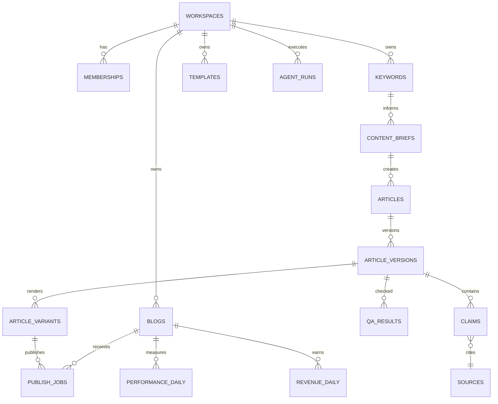

# Database Schema — PostgreSQL / Supabase
**목표:** 멀티테넌트, 감사 가능, 콘텐츠 원본·버전·수익 분리

## 1. 엔티티 관계

## 2. 기본 테이블 계약
| 테이블 | 필수 컬럼 | 제약/설명 |
|---|---|---|
| workspaces | id UUID, name, owner_id, plan | 조직 경계 |
| memberships | workspace_id, user_id, role | UNIQUE(workspace_id,user_id), enum owner/admin/editor/reviewer/viewer |
| blogs | id, workspace_id, platform, domain, status | blog platform enum |
| channel_connections | id, blog_id, credential_ref, scopes, state | **토큰 자체 저장 금지** |
| keywords | id, workspace_id, phrase, locale, intent, priority | 워크스페이스 범위 중복 정책 |
| keyword_clusters | id, workspace_id, label, parent_id | seasonality optional |
| content_briefs | id, keyword_id, template_id, target_audience, status | 근거 필수 |
| templates | id, workspace_id, slug, version, blocks_json | JSON schema validation |
| articles | id, workspace_id, brief_id, owner_id, state | 상태 enum |
| article_versions | id, article_id, version, markdown, title, content_hash | immutable approved snapshots |
| sources | id, workspace_id, url, title, checked_at, license_note | URL uniqueness candidate |
| claims | id, article_version_id, source_id, text, verification_state | 검증 결과 |
| qa_results | id, article_version_id, score, blockers_json, reviewer_id | fail closed |
| article_variants | id, article_version_id, blog_id, title, html, status | 채널별 독립 결과 |
| publish_jobs | id, article_variant_id, blog_id, idempotency_key, state, remote_id, remote_url | UNIQUE(blog_id,idempotency_key) |
| performance_daily | blog_id, article_variant_id?, date, clicks, impressions | 검색 데이터 |
| revenue_daily | blog_id, date, provider, amount, currency, is_estimated | 실측/추정 구분 |
| agent_runs | id, workspace_id, task, model, tokens_in, tokens_out, cost_estimate, status | 모델별 계량 |
| audit_logs | id, workspace_id, actor_id, action, payload, created_at | 보안 감사 |

## 3. 주요 상태 값
Article: idea → researching → briefing → drafting → qa_pending → needs_revision → approval_pending → approved → export_ready → publishing/manual_pending → published → monitoring → update_due.
PublishJob: queued, running, manual_pending, succeeded, failed, cancelled, needs_attention.

## 4. RLS 인수 테스트
- Workspace A의 editor는 Workspace B의 글, 출처, 비용 데이터를 읽거나 수정할 수 없다.
- Viewer는 글 승인/발행을 못 한다.
- Reviewer는 QA 검수는 가능하나 관리자 설정/credential_ref 변경 금지.
- service_role은 서버/워커에서만 접근하고 사용자 요청에 직접 사용하지 않는다.
- 모든 외래키는 동일 workspace 경계를 재검증한다.

## 5. 인덱스/운영
- keywords(workspace_id, lower(phrase)); articles(workspace_id, state); publish_jobs(state, scheduled_at).
- 성과: (blog_id, date), (article_variant_id, date) 인덱스 및 원본 데이터 소스 보존.
- 승인 후 내용 변경 시 승인 무효 처리.
- 삭제·개인정보 최소화·보존기간·백업·복원 연습 별도 운영정책으로 관리.

**본 문서는 논리 스키마이며 실행용 SQL migration이 아니다.** 구현 단계에서 SQL/제약/RLS 테스트를 작성한다.
