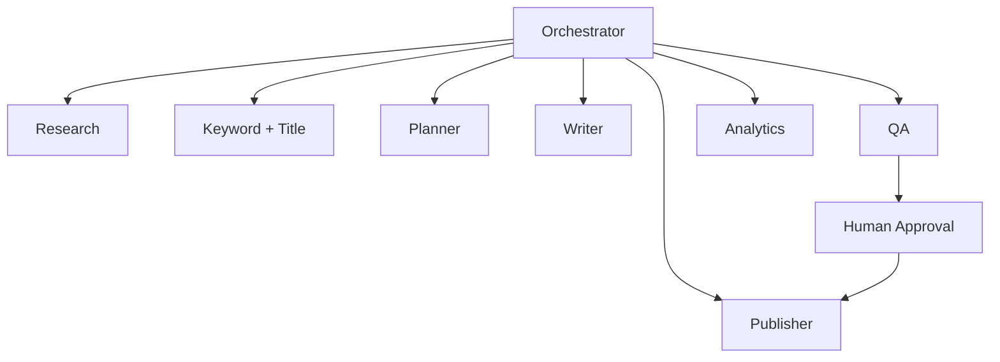

# AGENTS — Development & AI Agent Contract

## 1. 개발 조직
- **Claude Code Opus (Orchestrator):** 작업 분해, 아키텍처/ADR 결정, 보안/품질 최종 게이트.
- **Claude Code Sonnet (Architecture & UX):** UI/UX, 데이터 계약, 화면 구조, 문서 개선.
- **Codex (Implementation & Review):** 구현/테스트/성능 검토. 개별 작업 산출물 및 회귀 테스트 제공.
- 실제 설치 모델/별칭은 로컬 환경에서 확인한다. 역할은 특정 모델 버전에 종속되지 않는다.

## 2. 충돌 회피
작업마다 파일 소유 범위, 목표, 수용 기준, 브랜치, 변경 가능 범위를 지정. 동일 파일에 동시 작업 금지. 구현은 별도 브랜치/PR, 타 에이전트는 읽기/리뷰 중심.

## 3. 제품 내 AI 조직

- Research: 출처 URI/확인 시점/인용 구간.
- Keyword: 의도·키워드 클러스터·제목 후보·불확실성.
- Writer: 선택 템플릿에 맞춘 원고와 claim 목록.
- QA: 근거 연결·거짓 후기·광고 정책·중복/권리 이슈, 차단 조건.
- Publisher: 승인 버전만 출력, API 재시도 멱등성/수동 기록.
- Analytics: 출처별 실측 지표와 가정 분리.

## 4. 작업 계약 형식
```text
TASK_ID:
OWNER:
FILES:
INPUT_DOCS:
DELIVERABLE:
ACCEPTANCE_TESTS:
SECURITY_RISKS:
DEPENDENCIES:
REPORT:
```
에이전트는 작업 결과를 변경 파일/테스트 결과/실패 항목/다음 단계로 보고한다.

## 5. 절대 불변
1. 인가되지 않은 외부 발행 불가.
2. 타 workspace 데이터 접근 불가.
3. 비밀키/토큰 노출 금지.
4. 근거 없는 금융·건강·정부 정보 자동 발행 금지.
5. 실측 매출과 추정 매출 혼합 금지.
6. 공식 제공되지 않는 플랫폼 API를 존재하는 것처럼 가정 금지.

## 6. 테스트 계약
- Unit: CSV 스키마, 템플릿/제목 평가, 구조화 출력, 상태 전이.
- Integration: RLS, Supabase, n8n callback, CMS 어댑터 mock, 429/5xx 재시도.
- E2E: CSV → 브리프 → AI → QA → 승인 → 외부 초안/수동 패키지.
- Negative: 외부 발행 전 승인 누락, 교차 테넌트, 잘못된 원고/URL, 중복 job, 인증 실패.

## 7. 코드 리뷰 Gate
TypeScript strict, 서버/클라이언트 경계 준수, 최소권한, 오류 리포팅, 접근성, 리소스 사용량, 테스트 커버리지, 문서 변경 동반.
