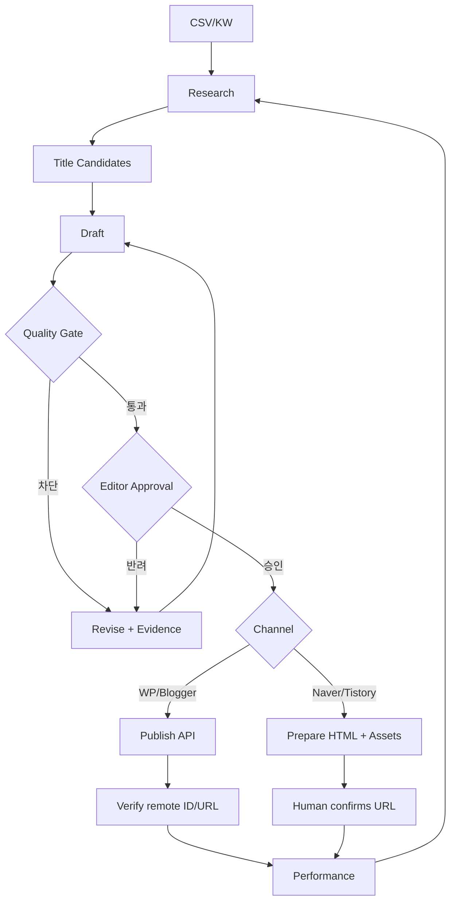

# n8n Workflow Specifications — ContentFlow AI v2.1

**v2.1 범위 보강:** [PRD](../01-planning/PRD.md)가 최초 출시 범위를 결정한다. 아래 목록은 전체 목표이며, MVP는 WP 초안/티스토리 export/CSV 성과 입력이다. Blogger API, 자동 예약/수집은 후속이다.

## 1. 설계 원칙
n8n은 오케스트레이션/재시도 담당, Supabase가 사실상 원본 상태(Source of Truth). 외부 발행은 승인된 immutable snapshot만. 웹훅 인증, idempotency key, 지수 백오프, 모델 예산 관리.

## 2. 워크플로우 목록
| ID | 이름 | 입력 → 결과 |
|---|---|---|
| WF-01 | CSV Import | CSV → 중복 검사/키워드 |
| WF-02 | Research/Brief | 키워드 → 출처/독자/의도 브리프 |
| WF-03 | Title Lab | 브리프 → 제목 5개/평가 |
| WF-04 | Draft Generation | 브리프·템플릿 → 원고와 주장 |
| WF-05 | Quality Gate | 주장/출처/정책 검사 → 승인 대기/반려 |
| WF-06 | Publish | 승인 스냅샷 → CMS API 또는 수동 패키지 |
| WF-07 | Performance Ingest | 검색·광고 데이터 → 일별 기록 |
| WF-08 | Update Monitor | 시한 지난 정보 → 재조사 작업 |
| WF-09 | Budget/Safety | 일별 토큰/호출 제한, 오류/보안 경고 |

## 3. 주요 상태흐름

## 4. WF-01 CSV Import
Input: UTF-8 CSV fields `category,keyword,intent,priority,title`. 행별 검증, 오류 행별 사유; 다른 워크스페이스와 절대 병합 금지. output: imported/duplicates/rejected.

## 5. WF-02~04
Research 단계는 출처의 제목/URL/확인 시각을 기록. Title Lab은 5개 후보, 제목 근거, 과장/사실 여부. Writer는 템플릿 기반 JSON 구조화 출력. 모델 오류/타임아웃 발생 시 실패 기록과 제한된 재시도.

## 6. WF-05 QA
Hard blockers: 근거 없는 민감 주제, 거짓 경험, 제휴 고지 누락, 이미지 권리 불명, 스팸성 중복, 외부 URL 오류. 점수는 보조 지표로만 사용하며 중요 차단 사유를 점수로 상쇄할 수 없다.

## 7. WF-06 Publish
Preconditions: `approved_version_id`, 권한, 계정 연결, idempotency_key. WordPress/Blogger: 안전한 초안 생성→원격 ID/URL 확인→상태 업데이트. 네이버/티스토리: HTML/이미지/태그 export → 사람이 발행 → URL 확인. 중간에 예외가 나면 불명확한 성공 상태를 먼저 조회해 중복 발행 방지.

## 8. WF-07/08
Search Console은 검색 노출/클릭/CTR, GA4는 방문/행동을 별도 적재한다. 색인은 별도 검사 또는 운영자 확인으로 기록한다. 광고 데이터는 출처·정산 상태·귀속 수준을 분리한다. 정보 갱신 주기는 콘텐츠 위험도(정책/가격/법률 등에 차등).

## 9. WF-09 Budget & Safety
워크스페이스별 일/월 예산, 실행당 최대 토큰, 모델별 비용 추정, 요청량/재시도 상한. 경계 초과 시 생성/발행 작업 보류. 모든 민감 토큰은 secret references.

## 10. 예외 처리 표
| 상황 | 대응 |
|---|---|
| 429 | Retry-After 지키며 지수 백오프 |
| 5xx/타임아웃 | 제한된 재시도, 원격 중복 검증 |
| 401/403 | 연결 문제 알림, 자동 반복 금지 |
| 본문 포맷 오류 | 재생성 또는 편집 대기 |
| QA Hard Block | publish 불가, 근거 보완 |
| 수동 게시 미확인 | manual_pending 유지 |
| 광고 API 미연결 | 미연결 상태 표시(0원으로 채우지 않음) |

## 11. 인수 테스트
승인 없는 외부 발행 불가; 중복 webhook → 1개 job; 복구 가능한 실패 이력; API 연결 무효 시 안전 차단; 실제/추정 수익 구분; 이력 변경 시 감사 로그.

## 12. v2.1 사이트/보고서/개선 흐름

| ID | 입력 → 처리 → 결과 | 완료/예외 |
|---|---|---|
| WF-10 준비 점검 | 블로그/운영자 증빙 → 항목/근거/확인 시각 → 다음 작업 | 미확인과 실패 구분; 광고 미승인이 일반 글 발행을 막지 않음 |
| WF-11 렌더 패키지 | 승인 대상 원고+고정 프로필 → 정제 HTML/미리보기 → render bundle 승인 | 프로필 변경은 재승인, 임의 script 차단 |
| WF-12 보고서 수입 | 출처별 CSV → 스키마/통화/시간대/범위 검증 → batch/성과/수익 | 미지원 형식·부분 기간 중첩 거절; 동일 파일 멱등 처리 |
| WF-13 URL 귀속 | PAGE_URL/공개 URL → 정규화/canonical 검토 → article mapping | 충돌/미매핑 수익은 별도 보존 |
| WF-14 개선 큐 | 비교 가능한 지표+원가+갱신 시점 → 근거 있는 작업 제안 | 승인 후 수정, 관측 기간 기록, 자동 효과 단정 금지 |

WF-11은 기존 WF-05 QA에서 프로필 호환성과 정제 결과를 검수한 뒤 승인을 받는 상세 단계다. WF-06은 정확히 승인된 bundle/hash만 받아 전달한다. 초안 전달 성공은 `draft_created`, export 성공은 `manual_pending`; 둘 다 운영자의 공개 URL 확인 뒤 `succeeded/published`로 전이한다. 기존 7절의 API 경로 중 자동 공개는 후속이다.

WF-12는 WF-07의 MVP 입력 경로다. 출처/대상 사이트/보고 기간/차원·필터/시간대/통화를 report_key로 식별한다. 같은 기간 교체는 이전 batch를 superseded 처리하고 새 batch만 집계한다. 부분 기간 중첩은 거절한다. 원본 데이터와 변경 이력을 보존한다. 사이트 합계/페이지 상세/월 정산은 별도 경로로 계산하고 더하지 않는다. API 관측 예상 수익도 `provider_estimated`이며, 누락은 N/A다.

추가 인수 시나리오: 다른 tenant의 보고서 입력 거절, CSV 재수입 시 합계 불변, 미매핑 URL 보존, 시간대/통화가 다른 보고서 무조건 병합 금지, GSC 검색 수집만으로 색인 완료 처리 금지, GA4 조회수를 공식 AdSense RPM 분모로 사용 금지.
