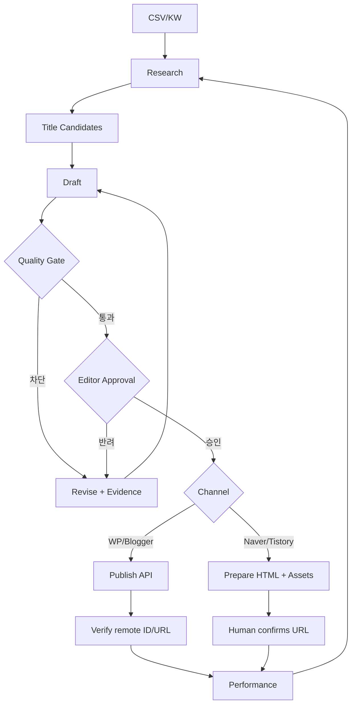

# n8n Workflow Specifications — ContentFlow AI v2.0

## 1. 설계 원칙
n8n은 오케스트레이션/재시도 담당, Supabase가 사실상 원본 상태(Source of Truth). 외부 발행은 승인된 immutable snapshot만. 웹훅 인증, idempotency key, 지수 백오프, 모델 예산 관리.

## 2. 워크플로우 목록
| ID | 이름 | 입력 → 결과 |
|---|---|---|
| WF-01 | CSV Import | CSV → 중복 검사/키워드 |
| WF-02 | Research/Brief | 키워드 → 출처/독자/의도 브리프 |
| WF-03 | Title Lab | 브리프 → 제목 5개/평가 |
| WF-04 | Draft Generation | 브리프·템플릿 → 원고와 주장 |
| WF-05 | Quality Gate | 주장/출처/정책 검사 → 승인 대기/반려 |
| WF-06 | Publish | 승인 스냅샷 → CMS API 또는 수동 패키지 |
| WF-07 | Performance Ingest | 검색·광고 데이터 → 일별 기록 |
| WF-08 | Update Monitor | 시한 지난 정보 → 재조사 작업 |
| WF-09 | Budget/Safety | 일별 토큰/호출 제한, 오류/보안 경고 |

## 3. 주요 상태흐름

## 4. WF-01 CSV Import
Input: UTF-8 CSV fields `category,keyword,intent,priority,title`. 행별 검증, 오류 행별 사유; 다른 워크스페이스와 절대 병합 금지. output: imported/duplicates/rejected.

## 5. WF-02~04
Research 단계는 출처의 제목/URL/확인 시각을 기록. Title Lab은 5개 후보, 제목 근거, 과장/사실 여부. Writer는 템플릿 기반 JSON 구조화 출력. 모델 오류/타임아웃 발생 시 실패 기록과 제한된 재시도.

## 6. WF-05 QA
Hard blockers: 근거 없는 민감 주제, 거짓 경험, 제휴 고지 누락, 이미지 권리 불명, 스팸성 중복, 외부 URL 오류. 점수는 보조 지표로만 사용하며 중요 차단 사유를 점수로 상쇄할 수 없다.

## 7. WF-06 Publish
Preconditions: `approved_version_id`, 권한, 계정 연결, idempotency_key. WordPress/Blogger: 안전한 초안 생성→원격 ID/URL 확인→상태 업데이트. 네이버/티스토리: HTML/이미지/태그 export → 사람이 발행 → URL 확인. 중간에 예외가 나면 불명확한 성공 상태를 먼저 조회해 중복 발행 방지.

## 8. WF-07/08
Search Console/GA4: 유입/CTR/색인 등 실제 데이터만. 광고 수익 API 데이터는 제공 가능 범위 내에서 집계하며 추정/실측 구분. 정보 갱신 주기는 콘텐츠 위험도(정책/가격/법률 등에 차등).

## 9. WF-09 Budget & Safety
워크스페이스별 일/월 예산, 실행당 최대 토큰, 모델별 비용 추정, 요청량/재시도 상한. 경계 초과 시 생성/발행 작업 보류. 모든 민감 토큰은 secret references.

## 10. 예외 처리 표
| 상황 | 대응 |
|---|---|
| 429 | Retry-After 지키며 지수 백오프 |
| 5xx/타임아웃 | 제한된 재시도, 원격 중복 검증 |
| 401/403 | 연결 문제 알림, 자동 반복 금지 |
| 본문 포맷 오류 | 재생성 또는 편집 대기 |
| QA Hard Block | publish 불가, 근거 보완 |
| 수동 게시 미확인 | manual_pending 유지 |
| 광고 API 미연결 | 미연결 상태 표시(0원으로 채우지 않음) |

## 11. 인수 테스트
승인 없는 외부 발행 불가; 중복 webhook → 1개 job; 복구 가능한 실패 이력; API 연결 무효 시 안전 차단; 실제/추정 수익 구분; 이력 변경 시 감사 로그.
